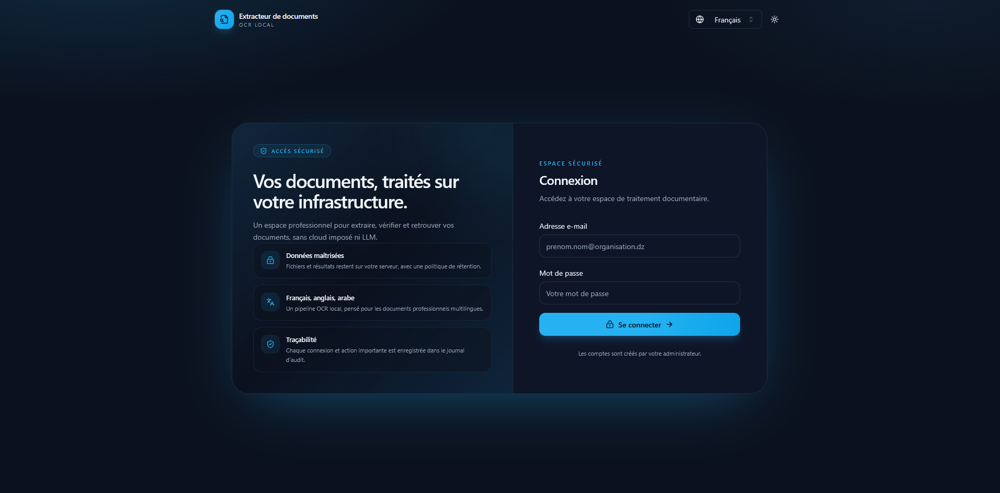
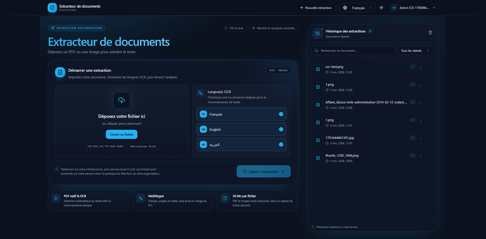
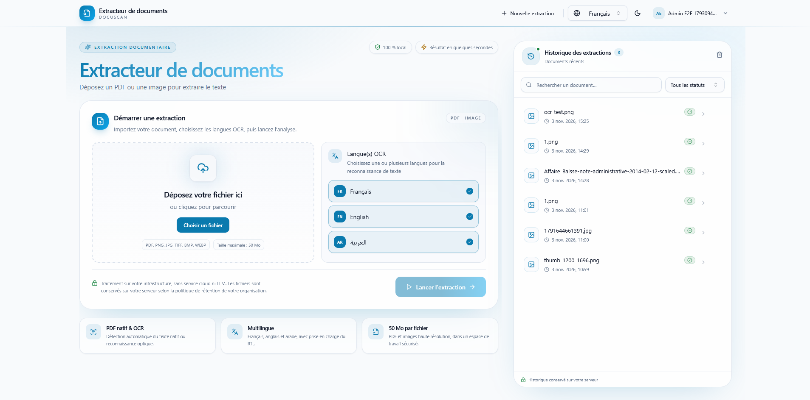
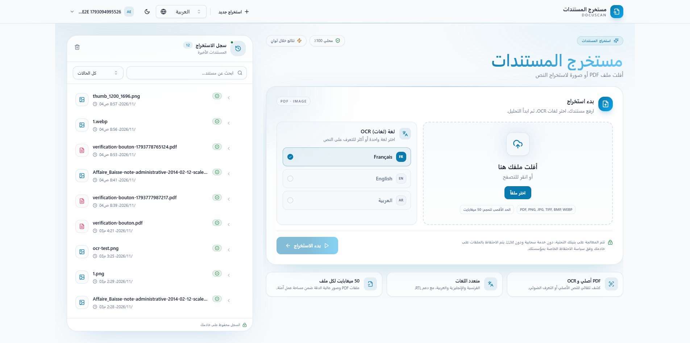
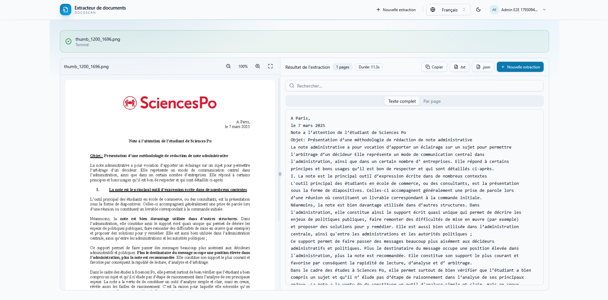
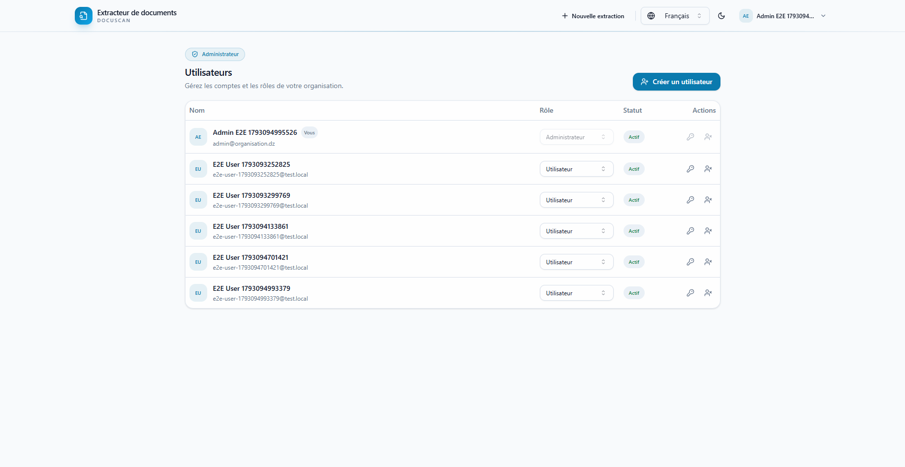

<div align="center">
  <h1>Document Extractor</h1>
  <p><strong>Plateforme on-premise d'extraction de texte PDF &amp; image — OCR français, anglais et arabe</strong></p>

  
  
  
  
  
  
  
  
  
  

  <p>
    <a href="#français">Français</a> ·
    <a href="#english">English</a> ·
    <a href="Document-Extractor-Documentation-FR-EN.pdf">PDF</a>
  </p>
</div>

---

## Français

### Présentation

**Document Extractor** est une plateforme complète et auto-hébergée qui transforme
des PDF (natifs ou scannés) et des images en texte exploitable. Elle réunit dans
un même dépôt :

- **`document-extraction-front-end/`** — une interface React 18/TypeScript permettant de se connecter,
  déposer des fichiers, suivre le traitement, comparer l'aperçu et le texte,
  rechercher, éditer, copier et télécharger les résultats ;
- **`document-extraction-api/`** — une API Spring Boot 3.3 qui gère
  l'authentification JWT, les organisations et rôles, la file de traitement
  durable, le stockage des fichiers, l'OCR et le journal d'audit.

L'OCR est exécuté **localement** avec **Tesseract 5** et **Apache PDFBox**.
Une extraction de champs par **LLM local Ollama** peut compléter l'extraction
déterministe lorsqu'elle est explicitement activée (`OLLAMA_ENABLED=true`).
Aucun service cloud, aucun modèle de vision cloud et aucun `pgvector` ne sont
utilisés : les documents restent sur l'infrastructure de l'organisation.

### Points clés

- **OCR français, anglais et arabe** (`fra`, `eng`, `ara`), avec support RTL,
  normalisation Unicode et passes multi-schémas.
- **PDF natifs, PDF scannés et images** : PDF, PNG, JPEG, TIFF, BMP, WEBP.
- **Limite par défaut** : 50 Mo par fichier et 50 pages par document.
- **Traitement asynchrone durable** : l'upload renvoie `202 Accepted`, un worker
  revendique le job en base et le traite ; les jobs interrompus sont repris après
  redémarrage.
- **Historique serveur** : recherche par nom ou contenu, filtre par statut,
  pagination, aperçu authentifié et téléchargement TXT/JSON.
- **Champs traçables** : extraction déterministe de `reference_number` et
  `document_date`, complétée en option par un LLM local Ollama pour les clés
  manquantes ; source page/ligne avec bbox normalisée, statuts `VERIFIED` /
  `UNVERIFIED` / `AMBIGUOUS` et corrections append-only appliquées à toute la
  lignée du document.
- **Comptes et rôles** : `ADMIN`, `REVIEWER`, `USER`, avec portée par organisation.
- **Sécurité** : BCrypt, JWT signé, révocation de session, limitation des
  tentatives de connexion, politique de mot de passe 12–128 caractères.
- **Stockage** : disque local en développement, **MinIO/S3** avec Docker Compose.
- **Exploitation** : PostgreSQL 16, migrations Flyway, rétention configurable,
  audit, profils TLS et Prometheus optionnels, scripts de sauvegarde/restauration.
- **IA générative locale optionnelle** : Ollama (`llama3.2:1b` par défaut),
  désactivé par défaut ; aucune valeur acceptée sans correspondance verbatim
  dans le texte source.

### IA intégrée et technologies

Cette version combine deux usages de l'IA, tous deux **locaux** :

- **OCR** : **Tesseract 5**, moteur à réseaux de neurones **LSTM**, utilisé via
  **Tess4J 5.13.0** pour les PDF scannés et les images ;
- **Extraction de champs** : **Ollama** avec le modèle `llama3.2:1b`, utilisé
  uniquement pour compléter les clés que les règles déterministes n'ont pas
  trouvées. L'option est **désactivée par défaut**.

Aucun service cloud, aucun embedding et aucun `pgvector` ne sont utilisés.

| Technologie | Version | Usage |
| --- | --- | --- |
| Tesseract 5 (LSTM) | via Tess4J 5.13.0 | OCR local français, anglais et arabe, y compris RTL |
| Apache PDFBox | 3.0.5 | Texte natif, rendu des pages et positions des lignes |
| Ollama | 0.35+ (testé) | Extraction IA locale optionnelle des champs manquants |
| llama3.2:1b | — | Modèle local par défaut |
| Spring Boot | 3.3.13 / Java 21 | API REST, worker asynchrone et sécurité |
| Prétraitement Java2D | — | Niveaux de gris, mise à l'échelle, redressement ±5°, binarisation Otsu/Sauvola |
| PostgreSQL 16 / H2 | — | Métadonnées, jobs, audit ; H2 pour les tests |
| React 18 / TypeScript / Vite 5 | — | Interface de revue et exports |

Les champs structurés `reference_number` et `document_date` sont d'abord extraits
par des **règles déterministes**. Ollama n'est appelé que si une clé manque. Une
valeur renvoyée par le modèle n'est acceptée que si elle apparaît **verbatim**
sur une ligne portant un libellé reconnu (ou seule sur sa ligne). Une valeur
trouvée sans span est stockée `UNVERIFIED` ; une valeur absente du texte est
ignorée ; une date non parsable est ignorée et une date ambiguë reste
`AMBIGUOUS`. Aucune géométrie n'est inventée.

### Captures d'écran

Les captures suivantes proviennent de l'interface réelle, en thèmes sombre et clair,
en français et en arabe (RTL).



*Page de connexion sécurisée.*



*Espace d'extraction, thème sombre : dépôt du fichier, langues OCR et historique.*



*Espace d'extraction, thème clair.*



*Interface arabe (RTL) : le sens de lecture et la mise en page sont inversés.*



*Résultat : aperçu du document et texte OCR côte à côte, avec export TXT/JSON.*



*Administration des utilisateurs et des rôles.*

### Architecture

```text
Navigateur
   │  HTTP/HTTPS
   ▼
Frontend React (nginx, port hôte 8081)
   │  /api/v1/  (proxy nginx)
   ▼
API Spring Boot (port interne 8080, port hôte 18080 dans cette configuration)
   ├── PostgreSQL 16 ......... métadonnées, utilisateurs, jobs, audit
   ├── MinIO / S3 ............ fichiers source
   ├── Worker OCR ............ Tesseract 5 + PDFBox
   └── Ollama (optionnel) .... extraction IA locale des champs manquants
```

Le navigateur appelle toujours `/api/v1/...` en relatif. En Docker, nginx sert
l'application React et proxifie `/api/v1/` vers le service `backend:8080`. Le
frontend n'a donc pas besoin de connaître l'adresse publique de l'API.

Flux d'un document :

1. l'utilisateur dépose un fichier et choisit les langues OCR ;
2. l'API valide le fichier, le stocke et crée un job `PENDING` ;
3. le worker passe le job en `PROCESSING`, exécute PDFBox/Tesseract et enregistre
   le texte et les pages ;
4. le frontend interroge le statut jusqu'à `COMPLETED` ou `FAILED` ;
5. le résultat peut être consulté, recherché, copié ou téléchargé.

### Structure du dépôt

```text
.
├── document-extraction-api/          # Backend Spring Boot (Java 21)
│   ├── src/main/java/dz/DocuScan/document/
│   │   ├── config/                   # propriétés, CORS, stockage
│   │   ├── controller/               # auth, documents, extractions, users, audit
│   │   ├── dto/                      # réponses API
│   │   ├── exception/                # ProblemDetail
│   │   ├── extractor/                # PDFBox, Tesseract, prétraitement
│   │   ├── model/                    # utilisateur, rôle, job, statut
│   │   ├── repository/               # JDBC
│   │   ├── security/                 # JWT, filtre, Spring Security
│   │   └── service/                  # auth, extraction, stockage, worker, audit
│   ├── src/main/resources/db/migration/  # schéma Flyway
│   ├── benchmark/                    # corpus synthétique et harness CER/WER
│   ├── deploy/                       # nginx TLS et Prometheus
│   ├── scripts/                      # sauvegarde et restauration
│   ├── docker-compose.yml
│   ├── Dockerfile
│   ├── DEPLOYMENT.md
│   └── SECURITY.md
├── document-extraction-front-end/    # Frontend React/Vite
│   ├── src/
│   │   ├── api/                      # client Axios, auth, types, erreurs
│   │   ├── components/ui/            # shadcn/ui
│   │   ├── features/auth/            # AuthProvider, login, routes protégées
│   │   ├── features/users/           # administration des comptes
│   │   ├── features/extraction/      # parcours principal
│   │   ├── i18n/                     # français, anglais, arabe (RTL)
│   │   └── utils/                    # validation, stockage, recherche
│   ├── e2e/                          # parcours Playwright
│   ├── Dockerfile
│   ├── nginx.conf
│   └── README.md
└── README.md                         # ce fichier
```

### Stack technique

| Domaine | Choix |
| --- | --- |
| Frontend | React 18, TypeScript 5.5, Vite 5 |
| UI | Tailwind CSS 3, shadcn/ui (Radix UI), lucide-react |
| Données front | TanStack Query 5, Axios, React Router 7 |
| PDF front | react-pdf / pdf.js (worker bundlé par Vite) |
| i18n | react-i18next — français, anglais, arabe (RTL) |
| Backend | Java 21, Spring Boot 3.3, Maven 3.9 |
| Sécurité | Spring Security, JWT (JJWT), BCrypt |
| Base | PostgreSQL 16 (Docker/production), H2 fichier (local), Flyway |
| Stockage | Disque local ou MinIO / S3 |
| OCR | Tesseract 5, Tess4J, Leptonica |
| Extraction IA (option) | Ollama `llama3.2:1b`, client HTTP JDK |
| PDF | Apache PDFBox 3 |
| Détection MIME | Apache Tika 3 |
| File de jobs | Table `jobs` PostgreSQL, verrouillage transactionnel |
| Tests | JUnit, Mockito, Vitest, React Testing Library, MSW, Playwright |
| Déploiement | Docker Compose, nginx, TLS et Prometheus optionnels |

### Démarrage rapide — Docker Compose

#### Prérequis

- Docker Engine 24+ avec Compose v2 ;
- au moins 4 Go de RAM, 2 CPU et de l'espace disque pour PostgreSQL, MinIO et les
  sauvegardes ;
- les certificats TLS de l'hôte public pour une exposition hors réseau de
  confiance (recommandé).

#### Lancer la stack

```bash
cd document-extraction-api
cp .env.example .env
# Windows : Copy-Item .env.example .env
# Éditer .env : mots de passe, JWT_SECRET, compte administrateur
docker compose config -q
docker compose up --build -d
docker compose ps
```

Le fichier Compose démarre :

| Service | Rôle | URL locale par défaut |
| --- | --- | --- |
| `frontend` | React servi par nginx | `http://localhost:8081` |
| `document-extraction-api` | API Spring Boot | `http://localhost:18080` avec `API_PORT=18080` (sinon `8080`) |
| `postgres` | PostgreSQL 16 | interne au réseau Compose |
| `minio` | Stockage S3-compatible | API `http://localhost:9000`, console `http://localhost:9001` |
| `minio-init` | Création du bucket | s'exécute une fois puis s'arrête |

Points utiles :

- **Swagger UI** : `http://localhost:18080/swagger-ui.html` (adapter au port
  `API_PORT`).
- **Santé de l'API** : `http://localhost:18080/actuator/health`.
- **Proxy front** : nginx sert le SPA et proxifie `/api/v1/` vers
  `http://backend:8080/api/v1/`.
- **`FRONTEND_CONTEXT`** : vaut `../document-extraction-front-end` par défaut ; lancez Compose depuis
  `document-extraction-api/` pour que le chemin reste correct.

#### Premier administrateur

Le premier compte est créé **uniquement si la base est vide**, à partir de :

| Variable | Rôle |
| --- | --- |
| `BOOTSTRAP_ORG_NAME` / `BOOTSTRAP_ORG_SLUG` | Nom et identifiant de l'organisation |
| `BOOTSTRAP_ADMIN_EMAIL` | Email de l'administrateur |
| `BOOTSTRAP_ADMIN_PASSWORD` | Mot de passe initial (12–128 caractères) |
| `BOOTSTRAP_ADMIN_NAME` | Nom affiché |

Connectez-vous avec ces valeurs, puis changez le mot de passe. Ne commitez jamais
le fichier `.env` : il est ignoré par Git et contient les secrets.

> Si la base contient déjà des données, le bootstrap est ignoré. Utilisez le
> compte existant ou, pour une remise à zéro **destructive**, arrêtez la stack et
> supprimez les volumes `postgres-data` et `minio-data`.

#### Vérifier rapidement

```bash
curl -fsS http://localhost:18080/actuator/health
curl -fsS -X POST http://localhost:18080/api/v1/auth/login \
  -H "Content-Type: application/json" \
  -d '{"email":"<admin-email>","password":"<admin-password>"}'
```

La réponse contient `accessToken`, `tokenType`, `expiresInSeconds` et `user`.

### Démarrage local sans Docker

#### Backend

Prérequis : **JDK 21**, **Maven 3.9+**, **Tesseract 5** avec les données `fra`,
`eng` et `ara`.

```bash
cd document-extraction-api
tesseract --list-langs
mvn spring-boot:run
```

Sous Windows :

```powershell
$env:TESSDATA_PREFIX = "C:\Program Files\Tesseract-OCR\tessdata"
mvn.cmd spring-boot:run
```

Par défaut, le profil local utilise **H2 fichier** et le **stockage disque** :

- API : `http://localhost:8080`
- Swagger UI : `http://localhost:8080/swagger-ui.html`
- Santé : `http://localhost:8080/actuator/health`
- Données : `./data/db` et `./data/storage`

Compte bootstrap par défaut : `admin@local.test` / `ChangeMe123!`. Changez-le
immédiatement via `BOOTSTRAP_ADMIN_EMAIL` et `BOOTSTRAP_ADMIN_PASSWORD`.

#### Extraction IA locale optionnelle (Ollama)

Le mode est **déterministe d'abord** : Ollama ne remplace jamais un champ trouvé
par une règle et une panne d'Ollama ne fait pas échouer le document.

```bash
# Une seule fois : télécharger le modèle local
ollama pull llama3.2:1b

# Vérifier que l'API Ollama répond
curl http://localhost:11434/api/tags

# Activer l'extraction IA pour l'API lancée sur l'hôte
export OLLAMA_ENABLED=true
export OLLAMA_BASE_URL=http://localhost:11434
export OLLAMA_MODEL=llama3.2:1b
```

Sous Windows :

```powershell
ollama pull llama3.2:1b
$env:OLLAMA_ENABLED = "true"
$env:OLLAMA_BASE_URL = "http://localhost:11434"
$env:OLLAMA_MODEL = "llama3.2:1b"
mvn.cmd spring-boot:run
```

En Docker, l'API joint Ollama sur l'hôte via
`http://host.docker.internal:11434` (valeur par défaut de `.env.example`). Sur
Linux, `docker-compose.yml` ajoute `host.docker.internal:host-gateway`. Si Ollama
tourne sur l'hôte, démarrez-le avec `OLLAMA_HOST=0.0.0.0:11434` pour qu'il
accepte les connexions du conteneur.

Une valeur IA n'est conservée que si elle est présente **verbatim** dans le texte
extrait ; sinon elle est ignorée ou marquée `UNVERIFIED`. Le test d'intégration
réel est opt-in : `OLLAMA_LIVE_TEST=true mvn -Dtest=OllamaLiveTest test`.

#### Frontend

Prérequis : **Node.js 22+** et **npm 10+**.

```bash
cd project
npm install
cp .env.example .env
# Windows : Copy-Item .env.example .env
npm run dev
```

Ouvrir `http://localhost:5173`.

Le proxy Vite redirige `/api/v1` vers `http://localhost:18080` par défaut (API
Docker). Pour un backend lancé localement sur `8080` :

```powershell
$env:VITE_DEV_API_PROXY = "http://localhost:8080"
npm.cmd run dev
```

### Rôles et comptes

| Rôle | Portée |
| --- | --- |
| `ADMIN` | Toute l'organisation : comptes, rôles, historique, audit |
| `REVIEWER` | Toute l'organisation : historique et relecture |
| `USER` | Ses propres documents uniquement |

- Un administrateur ne peut pas retirer ses propres droits.
- La création de compte, le changement de mot de passe et la réinitialisation
  admin appliquent la politique **12–128 caractères**.
- Un changement de mot de passe, une déconnexion ou une réinitialisation admin
  incrémente `users.token_version` : les anciens JWT sont rejetés immédiatement.
- Les tentatives de connexion sont limitées par email normalisé + IP (5 essais,
  fenêtre de 15 minutes, blocage de 15 minutes par défaut).

### Parcours utilisateur

1. **Connexion** avec le compte fourni par l'administrateur.
2. **Dépôt** d'un PDF ou d'une image, vérification du nom et de la taille,
   sélection des langues OCR.
3. **Traitement** asynchrone avec statut en temps réel et possibilité
   d'annulation.
4. **Résultat** en vue scindée : aperçu du fichier, texte complet ou par page,
   badge `NATIVE` / `OCR`, recherche, onglet **Champs** avec mise en évidence de
   la source et correction.
5. **Export** : copie, téléchargement `.txt` ou `.json` incluant les valeurs
   effectives des champs.
6. **Historique** : recherche, filtres, réouverture avec aperçu source,
   suppression.

### API principale

Base : `/api/v1` (via nginx en Docker, ou directement
`http://localhost:18080/api/v1`).

| Méthode | Chemin | Rôle |
| --- | --- | --- |
| `POST` | `/auth/login` | Connexion, retourne un JWT |
| `GET` | `/auth/me` | Profil courant |
| `PATCH` | `/auth/me` | Modifie le nom d'affichage |
| `POST` | `/auth/password` | Change le mot de passe courant |
| `POST` | `/auth/logout` | Révoque la session courante |
| `GET` | `/users` | Liste les comptes de l'organisation (admin) |
| `POST` | `/users` | Crée un compte (admin) |
| `PATCH` | `/users/{id}` | Change le rôle ou l'activation (admin) |
| `POST` | `/users/{id}/password` | Réinitialise un mot de passe (admin) |
| `POST` | `/extractions` | Crée une extraction multipart, `202 Accepted` |
| `GET` | `/extractions/{id}` | Statut et résultat |
| `GET` | `/extractions/{id}/file` | Fichier source authentifié |
| `GET` | `/extractions/{id}/download?format=txt\|json` | Résultat |
| `GET` | `/extractions/{id}/fields` | Champs, sources et corrections |
| `POST` | `/extractions/{id}/fields/{fieldKey}/corrections` | Correction append-only |
| `DELETE` | `/extractions/{id}` | Supprime un document |
| `GET` | `/documents` | Historique, recherche, pagination |
| `DELETE` | `/documents` | Vide les documents de l'utilisateur |
| `GET` | `/audit` | Journal d'audit (admin) |

Statuts d'extraction : `PENDING`, `PROCESSING`, `COMPLETED`, `FAILED`,
`CANCELLED`.

Les champs structurés sont stockés séparément du texte : valeur brute, valeur
normalisée (uniquement pour la comparaison) et valeur effective (dernière
correction de la lignée, sinon valeur brute). Une valeur sans source fiable est
`UNVERIFIED` ; une date dont l'ordre jour/mois ou le calendrier n'est pas prouvé
est `AMBIGUOUS`. Les corrections sont ajoutées à l'historique et ne modifient
jamais la valeur brute. Les exports TXT/JSON passent par le même service que
l'API ; le JSON conserve ses clés existantes et ajoute `schema_version` et
`fields`.

Cette itération est **déterministe d'abord**. Quand `OLLAMA_ENABLED=true`, un LLM
local (Ollama) complète uniquement les clés manquantes ; il ne remplace jamais
une valeur déterministe et une valeur IA doit correspondre à un span source
vérifiable, sinon elle est `UNVERIFIED` ou rejetée. Aucun `pgvector` n'est
utilisé. L'extraction des champs (règles puis Ollama) est terminée avant que le
statut `COMPLETED` ne soit persisté : dès qu'un client voit ce statut, la liste
`/fields` est déjà disponible.

#### Traçabilité des champs — état de l'itération

| Exigence | État | Mise en œuvre |
| --- | --- | --- |
| Modèle champ, source et correction | ✅ | Migration additive `V3`, tables `extracted_fields`, `field_sources`, `field_corrections` |
| Extraction déterministe | ✅ | `ReferenceNumberRule` et `DocumentDateRule`, label obligatoire |
| Complément LLM local optionnel | ✅ | Ollama `llama3.2:1b` pour les clés manquantes uniquement, validation verbatim + span |
| Source vérifiable | ✅ | Spans ligne PDF/OCR, bbox normalisée, page, dimensions et rotation |
| Valeurs brute, normalisée et effective | ✅ | Colonnes séparées, valeur effective calculée sans réécrire la valeur brute |
| Corrections append-only | ✅ | Historique complet, dernier correctif actif, propagation à la lignée |
| Arabe, chiffres arabes et bidi | ✅ | Valeur brute préservée, normalisation réservée à la comparaison, `dir="auto"` |
| Exports TXT/JSON | ✅ | Service partagé pour le téléchargement simple et le ZIP ; JSON additif |
| Revue dans l'interface | ✅ | Onglet **Champs**, statuts, source, surlignage, correction et historique |
| Isolation et rôles | ✅ | Requêtes filtrées par organisation, accès vérifié avant lecture/écriture |
| Tests et CI | ✅ | 90 tests backend, 44 tests frontend, E2E et job de couverture |

**Hors périmètre de cette itération** : `pgvector`, autres champs métier, spans
mot/caractère, validation à quatre yeux, table dédiée aux spans, SSO/MFA, quotas,
file Redis et export PDF avec couche texte. Les décisions sont détaillées dans
[`docs/adr/0001-field-traceability.md`](docs/adr/0001-field-traceability.md),
[`docs/adr/0002-ollama-field-extraction.md`](docs/adr/0002-ollama-field-extraction.md)
et l'état complet est suivi dans
[`docs/implementation-status.md`](docs/implementation-status.md).

Exemple d'upload :

```bash
TOKEN="<accessToken>"
curl -X POST http://localhost:18080/api/v1/extractions \
  -H "Authorization: Bearer $TOKEN" \
  -F "file=@facture.pdf" \
  -F "languages=fra+eng"
```

### Configuration

Le détail complet se trouve dans `document-extraction-api/.env.example` et
`document-extraction-front-end/.env.example`. Variables principales :

| Variable | Défaut | Description |
| --- | --- | --- |
| `SPRING_PROFILES_ACTIVE` | vide | `postgres` (Compose) ou `prod` |
| `DATABASE_URL` | H2 fichier | URL JDBC |
| `DATABASE_USERNAME` / `DATABASE_PASSWORD` | `sa` / vide | Identifiants JDBC |
| `JWT_SECRET` | secret de dev | **32 octets minimum**, obligatoire en production |
| `JWT_TTL_MINUTES` | `480` | Durée du token |
| `BOOTSTRAP_ENABLED` | `true` | Crée le premier compte si la base est vide |
| `BOOTSTRAP_ADMIN_EMAIL` / `BOOTSTRAP_ADMIN_PASSWORD` | — | Compte administrateur initial |
| `STORAGE_TYPE` | `local` | `local` ou `s3` |
| `MINIO_ENDPOINT` / `MINIO_BUCKET` | `http://localhost:9000` / `document-extraction` | Stockage S3 |
| `RETENTION_DAYS` | `30` | Purge automatique ; `0` désactive |
| `MAX_FILE_SIZE_BYTES` | `52428800` | 50 Mo |
| `MAX_PAGES` | `50` | Pages PDF / images |
| `OCR_DEFAULT_LANGUAGES` | `fra+eng` | Langues par défaut |
| `OLLAMA_ENABLED` | `false` | Active l'extraction IA locale des champs manquants |
| `OLLAMA_BASE_URL` | `http://localhost:11434` | Endpoint Ollama (Docker : `http://host.docker.internal:11434`) |
| `OLLAMA_MODEL` | `llama3.2:1b` | Modèle local déjà téléchargé |
| `OLLAMA_TIMEOUT_SECONDS` | `120` | Délai maximal par appel |
| `OLLAMA_MAX_INPUT_CHARACTERS` | `12000` | Troncature du texte envoyé au modèle |
| `OLLAMA_NUM_PREDICT` | `256` | Nombre maximal de tokens générés |
| `OLLAMA_NUM_CTX` | `8192` | Fenêtre de contexte |
| `OLLAMA_KEEP_ALIVE` | `5m` | Durée de résidence du modèle en mémoire |
| `CORS_ALLOWED_ORIGIN` | `http://localhost:5173` | Origine front autorisée |
| `API_PORT` / `FRONTEND_PORT` | `8080` / `8081` | Ports hôte Compose |
| `FRONTEND_CONTEXT` | `../document-extraction-front-end` | Dossier frontend pour le build Compose |
| `VITE_API_URL` | `/api/v1` | URL de base de l'API côté front |
| `VITE_DEV_API_PROXY` | `http://localhost:18080` | Cible du proxy Vite en développement |

> `VITE_API_URL` est injectée **au moment du build** par Vite. En Docker, le
> `Dockerfile` du frontend utilise `/api/v1` ; nginx fait le proxy vers le backend.

### Sécurité et exploitation

La checklist complète est dans
[`document-extraction-api/SECURITY.md`](document-extraction-api/SECURITY.md) et
le guide de déploiement dans
[`document-extraction-api/DEPLOYMENT.md`](document-extraction-api/DEPLOYMENT.md).

Minimum avant une mise en production :

- [ ] Remplacer tous les secrets d'exemple par des valeurs aléatoires.
- [ ] Définir `JWT_SECRET` (32 octets minimum) et un mot de passe admin de 12+
  caractères.
- [ ] Utiliser des identifiants PostgreSQL et MinIO dédiés.
- [ ] Épingler `MINIO_IMAGE` par digest après revue de la chaîne
  d'approvisionnement.
- [ ] Terminer TLS devant le front et l'API ; rediriger HTTP vers HTTPS.
- [ ] Restreindre `CORS_ALLOWED_ORIGIN` à l'origine publique exacte.
- [ ] Restreindre l'accès réseau à PostgreSQL, MinIO, Prometheus et au port API.
- [ ] Ne pas exposer la console MinIO publiquement.
- [ ] Configurer et tester les sauvegardes PostgreSQL + MinIO.
- [ ] Ajuster `RETENTION_DAYS` à la politique de l'organisation.
- [ ] Surveiller `/actuator/health`, `/actuator/prometheus`, les erreurs du worker
  et l'espace disque.

Sauvegarde et restauration (depuis `document-extraction-api/`) :

```bash
./scripts/backup.sh
./scripts/restore.sh <stamp> [backup-directory]
```

La restauration est **destructive** : prenez une sauvegarde fraîche et coupez le
trafic avant de l'exécuter. Les volumes Docker `postgres-data`, `minio-data` et
`prometheus-data` ne doivent jamais être supprimés en production.

### Tests et qualité

Backend :

```bash
cd document-extraction-api
mvn test
mvn -B verify
```

Frontend :

```bash
cd project
npm run typecheck
npm run lint
npm test
npm run build
```

Les parcours E2E Playwright nécessitent la stack Docker démarrée :

```bash
cd project
npm run test:e2e
```

Ils lisent `BOOTSTRAP_ADMIN_EMAIL` / `BOOTSTRAP_ADMIN_PASSWORD` depuis
`../document-extraction-api/.env`, ou `E2E_ADMIN_EMAIL` / `E2E_ADMIN_PASSWORD`.
`E2E_BASE_URL` permet de cibler une autre URL.

### Limites connues

- Tesseract n'est **pas un moteur d'écriture manuscrite** : l'arabe manuscrit
  reste en meilleur effort.
- Les tableaux complexes et l'ordre de lecture peuvent encore être imparfaits.
- La prévisualisation TIFF dépend du navigateur ; un message de repli et le
  téléchargement du fichier original sont fournis.
- Le benchmark OCR fourni est synthétique : il valide la chaîne et les trois
  langues, pas la précision sur un corpus client.
- Les images MinIO officielles ne sont plus publiées ; le miroir
  `elestio/minio:latest` doit être vérifié et épinglé, ou remplacé par un stockage
  S3 géré.
- Authentification locale uniquement : SSO, MFA, facturation et quotas par
  organisation sont prévus pour les versions suivantes.
- Les JWT sont stockés dans `localStorage` ; une CSP stricte est recommandée au
  niveau du proxy de production.
- **Traçabilité** : seuls `reference_number` et `document_date` sont extraits ;
  les spans sont au niveau ligne ; la dernière correction fait foi (pas de
  validation à quatre yeux ni de suppression) ; l'IA locale Ollama est
  optionnelle et désactivée par défaut ; aucun `pgvector`.

### Documentation détaillée

| Document | Contenu |
| --- | --- |
| [`document-extraction-api/README.md`](document-extraction-api/README.md) | Référence complète de l'API |
| [`document-extraction-api/DEPLOYMENT.md`](document-extraction-api/DEPLOYMENT.md) | Docker, TLS, Prometheus, sauvegarde, restauration |
| [`document-extraction-api/SECURITY.md`](document-extraction-api/SECURITY.md) | Contrôles et checklist de sécurité |
| [`document-extraction-api/benchmark/README.md`](document-extraction-api/benchmark/README.md) | Benchmark OCR synthétique |
| [`document-extraction-front-end/README.md`](document-extraction-front-end/README.md) | Référence complète du frontend |
| [`docs/adr/0001-field-traceability.md`](docs/adr/0001-field-traceability.md) | Décisions de traçabilité des champs |
| [`docs/adr/0002-ollama-field-extraction.md`](docs/adr/0002-ollama-field-extraction.md) | Décisions d'extraction IA locale avec Ollama |
| [`docs/implementation-status.md`](docs/implementation-status.md) | Matrice de vérification et reste à faire |

### Licence

Ce dépôt est distribué sous **licence propriétaire DocuScan — tous droits
réservés**. Le code peut être consulté, mais toute reproduction, modification,
distribution ou utilisation commerciale nécessite une autorisation écrite
préalable. Voir le fichier [`LICENSE`](LICENSE).

Pour toute demande d'autorisation, contactez le titulaire via son compte GitHub.

---

## English

### Overview

**Document Extractor** is a complete, self-hosted platform that turns PDFs
(native or scanned) and images into usable text. It combines two applications in
one repository:

- **`document-extraction-front-end/`** — a React 18/TypeScript interface to sign in, upload files,
  follow processing, compare the preview with the extracted text, search, edit,
  copy and download results;
- **`document-extraction-api/`** — a Spring Boot 3.3 API that handles JWT
  authentication, organizations and roles, the durable processing queue, file
  storage, OCR and the audit log.

OCR runs **locally** with **Tesseract 5** and **Apache PDFBox**. Field extraction
with a **local Ollama LLM** can complement the deterministic rules when it is
explicitly enabled (`OLLAMA_ENABLED=true`). No cloud service, no cloud vision
model and no `pgvector` are used: documents stay on the organization's
infrastructure.

### Key features

- **French, English and Arabic OCR** (`fra`, `eng`, `ara`) with RTL support,
  Unicode normalization and multi-script passes.
- **Native PDFs, scanned PDFs and images**: PDF, PNG, JPEG, TIFF, BMP, WEBP.
- **Default limits**: 50 MB per file and 50 pages per document.
- **Durable asynchronous processing**: upload returns `202 Accepted`; a worker
  claims the database job and processes it; interrupted jobs are recovered after
  a restart.
- **Server-side history**: search by name or content, status filter, pagination,
  authenticated preview and TXT/JSON download.
- **Traceable fields**: deterministic extraction of `reference_number` and
  `document_date`, optionally complemented by a local Ollama LLM for missing
  keys; page/line source with a normalized bbox, `VERIFIED` / `UNVERIFIED` /
  `AMBIGUOUS` statuses and append-only corrections applied across the document
  lineage.
- **Accounts and roles**: `ADMIN`, `REVIEWER`, `USER`, scoped to an organization.
- **Security**: BCrypt, signed JWT, session revocation, login throttling and a
  12–128 character password policy.
- **Storage**: local disk in development, **MinIO/S3** with Docker Compose.
- **Operations**: PostgreSQL 16, Flyway migrations, configurable retention,
  audit, optional TLS and Prometheus profiles, backup/restore scripts.
- **Optional local generative AI**: Ollama (`llama3.2:1b` by default), disabled
  by default; no value is accepted without a verbatim match in the source text.

### Integrated AI and technologies

This version combines two AI uses, both **local**:

- **OCR**: **Tesseract 5**, an **LSTM** neural OCR engine, used through
  **Tess4J 5.13.0** for scanned PDFs and images;
- **Field extraction**: **Ollama** with the `llama3.2:1b` model, used only to
  fill keys the deterministic rules did not produce. The option is **disabled
  by default**.

No cloud service, embedding or `pgvector` is used.

| Technology | Version | Purpose |
| --- | --- | --- |
| Tesseract 5 (LSTM) | via Tess4J 5.13.0 | Local French, English and Arabic OCR, including RTL |
| Apache PDFBox | 3.0.5 | Native text, page rendering and line positions |
| Ollama | 0.35+ (tested) | Optional local AI extraction of missing fields |
| llama3.2:1b | — | Default local model |
| Spring Boot | 3.3.13 / Java 21 | REST API, asynchronous worker and security |
| Java2D preprocessing | — | Grayscale, scaling, ±5° deskew, Otsu/Sauvola binarization |
| PostgreSQL 16 / H2 | — | Metadata, jobs, audit; H2 for tests |
| React 18 / TypeScript / Vite 5 | — | Review UI and exports |

Structured fields `reference_number` and `document_date` are extracted by
**deterministic rules** first. Ollama is called only when a key is missing. A
model value is accepted only when it appears **verbatim** on a line carrying a
recognized label (or alone on its line). A value found without a span is stored
as `UNVERIFIED`; a value absent from the text is discarded; an unparsable date is
discarded and an ambiguous date remains `AMBIGUOUS`. No geometry is invented.

### Screenshots

The following screenshots come from the real interface, in dark and light themes,
in French and Arabic (RTL).


*Secure sign-in page.*


*Extraction workspace, dark theme: file dropzone, OCR languages and history.*


*Extraction workspace, light theme.*


*Arabic interface (RTL): reading direction and layout are mirrored.*


*Result: document preview and OCR text side by side, with TXT/JSON export.*


*User and role administration.*

### Architecture

```text
Browser
   │  HTTP/HTTPS
   ▼
React frontend (nginx, host port 8081)
   │  /api/v1/  (nginx proxy)
   ▼
Spring Boot API (internal port 8080, host port 18080 in this setup)
   ├── PostgreSQL 16 ......... metadata, users, jobs, audit
   ├── MinIO / S3 ............ source files
   ├── OCR worker ............ Tesseract 5 + PDFBox
   └── Ollama (optional) ..... local AI extraction of missing fields
```

The browser always calls `/api/v1/...` relatively. In Docker, nginx serves the
React app and proxies `/api/v1/` to the `backend:8080` service, so the frontend
never needs the public API address.

Document flow:

1. the user uploads a file and selects OCR languages;
2. the API validates the file, stores it and creates a `PENDING` job;
3. the worker moves the job to `PROCESSING`, runs PDFBox/Tesseract and stores the
   text and pages;
4. the frontend polls until `COMPLETED` or `FAILED`;
5. the result can be reviewed, searched, copied or downloaded.

### Repository layout

```text
.
├── document-extraction-api/          # Spring Boot backend (Java 21)
│   ├── src/main/java/dz/DocuScan/document/
│   │   ├── config/                   # properties, CORS, storage
│   │   ├── controller/               # auth, documents, extractions, users, audit
│   │   ├── dto/                      # API responses
│   │   ├── exception/                # ProblemDetail
│   │   ├── extractor/                # PDFBox, Tesseract, preprocessing
│   │   ├── model/                    # user, role, job, status
│   │   ├── repository/               # JDBC
│   │   ├── security/                 # JWT, filter, Spring Security
│   │   └── service/                  # auth, extraction, storage, worker, audit
│   ├── src/main/resources/db/migration/  # Flyway schema
│   ├── benchmark/                    # synthetic corpus and CER/WER harness
│   ├── deploy/                       # nginx TLS and Prometheus
│   ├── scripts/                      # backup and restore
│   ├── docker-compose.yml
│   ├── Dockerfile
│   ├── DEPLOYMENT.md
│   └── SECURITY.md
├── document-extraction-front-end/    # React/Vite frontend
│   ├── src/
│   │   ├── api/                      # Axios client, auth, types, errors
│   │   ├── components/ui/            # shadcn/ui
│   │   ├── features/auth/            # AuthProvider, login, protected routes
│   │   ├── features/users/           # account administration
│   │   ├── features/extraction/      # main workflow
│   │   ├── i18n/                     # French, English, Arabic (RTL)
│   │   └── utils/                    # validation, storage, search
│   ├── e2e/                          # Playwright flows
│   ├── Dockerfile
│   ├── nginx.conf
│   └── README.md
└── README.md                         # this file
```

### Technology stack

| Area | Choice |
| --- | --- |
| Frontend | React 18, TypeScript 5.5, Vite 5 |
| UI | Tailwind CSS 3, shadcn/ui (Radix UI), lucide-react |
| Frontend data | TanStack Query 5, Axios, React Router 7 |
| Frontend PDF | react-pdf / pdf.js (Vite-bundled worker) |
| i18n | react-i18next — French, English, Arabic (RTL) |
| Backend | Java 21, Spring Boot 3.3, Maven 3.9 |
| Security | Spring Security, JWT (JJWT), BCrypt |
| Database | PostgreSQL 16 (Docker/production), H2 file (local), Flyway |
| Storage | Local disk or MinIO / S3 |
| OCR | Tesseract 5, Tess4J, Leptonica |
| AI extraction (optional) | Ollama `llama3.2:1b`, JDK HTTP client |
| PDF | Apache PDFBox 3 |
| MIME detection | Apache Tika 3 |
| Job queue | PostgreSQL `jobs` table, transactional locking |
| Tests | JUnit, Mockito, Vitest, React Testing Library, MSW, Playwright |
| Deployment | Docker Compose, nginx, optional TLS and Prometheus |

### Quick start — Docker Compose

#### Requirements

- Docker Engine 24+ with Compose v2;
- at least 4 GB RAM, 2 CPUs and disk space for PostgreSQL, MinIO and backups;
- TLS certificates for the public hostname when exposed outside a trusted
  network (recommended).

#### Start the stack

```bash
cd document-extraction-api
cp .env.example .env
# Windows: Copy-Item .env.example .env
# Edit .env: passwords, JWT_SECRET, administrator account
docker compose config -q
docker compose up --build -d
docker compose ps
```

The Compose file starts:

| Service | Purpose | Default local URL |
| --- | --- | --- |
| `frontend` | React served by nginx | `http://localhost:8081` |
| `document-extraction-api` | Spring Boot API | `http://localhost:18080` with `API_PORT=18080` (otherwise `8080`) |
| `postgres` | PostgreSQL 16 | internal Compose network |
| `minio` | S3-compatible storage | API `http://localhost:9000`, console `http://localhost:9001` |
| `minio-init` | Bucket creation | runs once then exits |

Useful endpoints:

- **Swagger UI**: `http://localhost:18080/swagger-ui.html` (adjust to
  `API_PORT`).
- **API health**: `http://localhost:18080/actuator/health`.
- **Frontend proxy**: nginx serves the SPA and proxies `/api/v1/` to
  `http://backend:8080/api/v1/`.
- **`FRONTEND_CONTEXT`**: defaults to `../document-extraction-front-end`; run Compose from
  `document-extraction-api/` so the path stays correct.

#### First administrator

The first account is created **only when the database is empty**, from:

| Variable | Purpose |
| --- | --- |
| `BOOTSTRAP_ORG_NAME` / `BOOTSTRAP_ORG_SLUG` | Organization name and slug |
| `BOOTSTRAP_ADMIN_EMAIL` | Administrator email |
| `BOOTSTRAP_ADMIN_PASSWORD` | Initial password (12–128 characters) |
| `BOOTSTRAP_ADMIN_NAME` | Display name |

Sign in with these values, then change the password. Never commit `.env`: it is
Git-ignored and contains secrets.

> If the database already contains data, bootstrap is skipped. Use the existing
> account, or — for a **destructive** reset — stop the stack and remove the
> `postgres-data` and `minio-data` volumes.

#### Quick verification

```bash
curl -fsS http://localhost:18080/actuator/health
curl -fsS -X POST http://localhost:18080/api/v1/auth/login \
  -H "Content-Type: application/json" \
  -d '{"email":"<admin-email>","password":"<admin-password>"}'
```

The response contains `accessToken`, `tokenType`, `expiresInSeconds` and `user`.

### Local development without Docker

#### Backend

Requirements: **JDK 21**, **Maven 3.9+**, **Tesseract 5** with the `fra`, `eng`
and `ara` language data.

```bash
cd document-extraction-api
tesseract --list-langs
mvn spring-boot:run
```

Windows:

```powershell
$env:TESSDATA_PREFIX = "C:\Program Files\Tesseract-OCR\tessdata"
mvn.cmd spring-boot:run
```

The local profile uses **file-based H2** and **disk storage** by default:

- API: `http://localhost:8080`
- Swagger UI: `http://localhost:8080/swagger-ui.html`
- Health: `http://localhost:8080/actuator/health`
- Data: `./data/db` and `./data/storage`

Default bootstrap account: `admin@local.test` / `ChangeMe123!`. Change it
immediately with `BOOTSTRAP_ADMIN_EMAIL` and `BOOTSTRAP_ADMIN_PASSWORD`.

#### Optional local AI extraction (Ollama)

The mode is **deterministic first**: Ollama never replaces a field found by a
rule, and an Ollama outage never fails the document.

```bash
# Once: pull the local model
ollama pull llama3.2:1b

# Check that the Ollama API responds
curl http://localhost:11434/api/tags

# Enable AI extraction for an API running on the host
export OLLAMA_ENABLED=true
export OLLAMA_BASE_URL=http://localhost:11434
export OLLAMA_MODEL=llama3.2:1b
```

Windows:

```powershell
ollama pull llama3.2:1b
$env:OLLAMA_ENABLED = "true"
$env:OLLAMA_BASE_URL = "http://localhost:11434"
$env:OLLAMA_MODEL = "llama3.2:1b"
mvn.cmd spring-boot:run
```

In Docker, the API reaches host Ollama through
`http://host.docker.internal:11434` (the `.env.example` default). On Linux,
`docker-compose.yml` adds `host.docker.internal:host-gateway`. When Ollama runs
on the host, start it with `OLLAMA_HOST=0.0.0.0:11434` so containers may connect.

An AI value is kept only when it appears **verbatim** in the extracted text;
otherwise it is discarded or marked `UNVERIFIED`. The real integration test is
opt-in: `OLLAMA_LIVE_TEST=true mvn -Dtest=OllamaLiveTest test`.

#### Frontend

Requirements: **Node.js 22+** and **npm 10+**.

```bash
cd project
npm install
cp .env.example .env
# Windows: Copy-Item .env.example .env
npm run dev
```

Open `http://localhost:5173`.

The Vite proxy forwards `/api/v1` to `http://localhost:18080` by default (the
Docker API). For a backend running locally on `8080`:

```powershell
$env:VITE_DEV_API_PROXY = "http://localhost:8080"
npm.cmd run dev
```

### Roles and accounts

| Role | Scope |
| --- | --- |
| `ADMIN` | Entire organization: accounts, roles, history, audit |
| `REVIEWER` | Entire organization: history and review |
| `USER` | Own documents only |

- An administrator cannot remove their own admin rights.
- Account creation, self-service password change and admin reset enforce the
  **12–128 character** policy.
- A password change, logout or admin reset increments `users.token_version`:
  existing JWTs are rejected immediately.
- Login attempts are throttled by normalized email + IP (5 attempts, 15-minute
  window, 15-minute block by default).

### User journey

1. **Sign in** with the account provided by the administrator.
2. **Upload** a PDF or image, check its name and size, select OCR languages.
3. **Processing** with live status and cancellation.
4. **Result** in a split view: file preview, full or per-page text, `NATIVE` /
   `OCR` badge, search, a **Fields** tab with source highlighting and correction.
5. **Export**: copy, `.txt` or `.json` download including effective field values.
6. **History**: search, filters, reopen with source preview, delete.

### Main API

Base: `/api/v1` (through nginx in Docker, or directly at
`http://localhost:18080/api/v1`).

| Method | Path | Purpose |
| --- | --- | --- |
| `POST` | `/auth/login` | Sign in, returns a JWT |
| `GET` | `/auth/me` | Current profile |
| `PATCH` | `/auth/me` | Update display name |
| `POST` | `/auth/password` | Change the current password |
| `POST` | `/auth/logout` | Revoke the current session |
| `GET` | `/users` | List organization accounts (admin) |
| `POST` | `/users` | Create an account (admin) |
| `PATCH` | `/users/{id}` | Change role or activation (admin) |
| `POST` | `/users/{id}/password` | Reset a password (admin) |
| `POST` | `/extractions` | Create a multipart extraction, `202 Accepted` |
| `GET` | `/extractions/{id}` | Status and result |
| `GET` | `/extractions/{id}/file` | Authenticated source file |
| `GET` | `/extractions/{id}/download?format=txt\|json` | Result |
| `GET` | `/extractions/{id}/fields` | Fields, sources and corrections |
| `POST` | `/extractions/{id}/fields/{fieldKey}/corrections` | Append-only correction |
| `DELETE` | `/extractions/{id}` | Delete a document |
| `GET` | `/documents` | History, search, pagination |
| `DELETE` | `/documents` | Clear the user's documents |
| `GET` | `/audit` | Audit log (admin) |

Extraction statuses: `PENDING`, `PROCESSING`, `COMPLETED`, `FAILED`,
`CANCELLED`.

Structured fields are stored separately from the text: raw value, normalized
value (comparison only) and effective value (latest correction in the lineage,
otherwise the raw value). A value without a reliable source is `UNVERIFIED`; a
date whose day/month order or calendar cannot be proven is `AMBIGUOUS`.
Corrections are appended to the history and never modify the raw value. TXT/JSON
exports use the same service as the API; JSON keeps every existing key and adds
`schema_version` and `fields`.

This iteration is **deterministic first**. When `OLLAMA_ENABLED=true`, a local
LLM (Ollama) only fills missing keys; it never replaces a deterministic value,
and an AI value must match a verifiable source span, otherwise it is
`UNVERIFIED` or discarded. No `pgvector` is used. Field extraction (rules, then
Ollama) finishes before the `COMPLETED` snapshot is persisted, so `/fields` is
already populated whenever a client observes that status.

#### Field traceability — iteration status

| Requirement | Status | Implementation |
| --- | --- | --- |
| Field, source and correction model | ✅ | Additive `V3` migration, `extracted_fields`, `field_sources`, `field_corrections` |
| Deterministic extraction | ✅ | `ReferenceNumberRule` and `DocumentDateRule`, label required |
| Optional local LLM complement | ✅ | Ollama `llama3.2:1b` for missing keys only, verbatim + span validation |
| Verifiable source | ✅ | PDF/OCR line spans, normalized bbox, page, dimensions and rotation |
| Raw, normalized and effective values | ✅ | Separate columns; effective value computed without rewriting the raw value |
| Append-only corrections | ✅ | Full history, latest active correction, lineage-wide propagation |
| Arabic, Arabic-Indic digits and bidi | ✅ | Raw value preserved, normalization limited to comparison, `dir="auto"` |
| TXT/JSON exports | ✅ | Shared service for single download and ZIP; additive JSON |
| Review UI | ✅ | **Fields** tab, statuses, source, highlighting, correction and history |
| Organization isolation and roles | ✅ | Organization-scoped queries, access checked before read/write |
| Tests and CI | ✅ | 90 backend tests, 44 frontend tests, E2E and coverage job |

**Out of scope for this iteration**: `pgvector`, additional business fields,
word/character spans, four-eyes validation, dedicated span table, SSO/MFA,
quotas, Redis queue and PDF export with a text layer. Decisions are documented in
[`docs/adr/0001-field-traceability.md`](docs/adr/0001-field-traceability.md) and
[`docs/adr/0002-ollama-field-extraction.md`](docs/adr/0002-ollama-field-extraction.md);
the complete status is tracked in
[`docs/implementation-status.md`](docs/implementation-status.md).

Upload example:

```bash
TOKEN="<accessToken>"
curl -X POST http://localhost:18080/api/v1/extractions \
  -H "Authorization: Bearer $TOKEN" \
  -F "file=@invoice.pdf" \
  -F "languages=fra+eng"
```

### Configuration

The full list is in `document-extraction-api/.env.example` and
`document-extraction-front-end/.env.example`. Main variables:

| Variable | Default | Description |
| --- | --- | --- |
| `SPRING_PROFILES_ACTIVE` | empty | `postgres` (Compose) or `prod` |
| `DATABASE_URL` | H2 file | JDBC URL |
| `DATABASE_USERNAME` / `DATABASE_PASSWORD` | `sa` / empty | JDBC credentials |
| `JWT_SECRET` | dev secret | **At least 32 bytes**, required in production |
| `JWT_TTL_MINUTES` | `480` | Token lifetime |
| `BOOTSTRAP_ENABLED` | `true` | Create the first account when the database is empty |
| `BOOTSTRAP_ADMIN_EMAIL` / `BOOTSTRAP_ADMIN_PASSWORD` | — | Initial administrator account |
| `STORAGE_TYPE` | `local` | `local` or `s3` |
| `MINIO_ENDPOINT` / `MINIO_BUCKET` | `http://localhost:9000` / `document-extraction` | S3 storage |
| `RETENTION_DAYS` | `30` | Automatic purge; `0` disables |
| `MAX_FILE_SIZE_BYTES` | `52428800` | 50 MB |
| `MAX_PAGES` | `50` | PDF pages / image frames |
| `OCR_DEFAULT_LANGUAGES` | `fra+eng` | Default languages |
| `OLLAMA_ENABLED` | `false` | Enable local AI extraction of missing fields |
| `OLLAMA_BASE_URL` | `http://localhost:11434` | Ollama endpoint (Docker: `http://host.docker.internal:11434`) |
| `OLLAMA_MODEL` | `llama3.2:1b` | Local model already pulled |
| `OLLAMA_TIMEOUT_SECONDS` | `120` | Per-call timeout |
| `OLLAMA_MAX_INPUT_CHARACTERS` | `12000` | Truncate text sent to the model |
| `OLLAMA_NUM_PREDICT` | `256` | Maximum generated tokens |
| `OLLAMA_NUM_CTX` | `8192` | Context window |
| `OLLAMA_KEEP_ALIVE` | `5m` | How long the model stays in memory |
| `CORS_ALLOWED_ORIGIN` | `http://localhost:5173` | Allowed frontend origin |
| `API_PORT` / `FRONTEND_PORT` | `8080` / `8081` | Compose host ports |
| `FRONTEND_CONTEXT` | `../document-extraction-front-end` | Frontend folder for the Compose build |
| `VITE_API_URL` | `/api/v1` | Frontend API base URL |
| `VITE_DEV_API_PROXY` | `http://localhost:18080` | Vite dev proxy target |

> Vite injects `VITE_API_URL` **at build time**. In Docker, the frontend
> `Dockerfile` uses `/api/v1`; nginx proxies it to the backend.

### Security and operations

The full checklist is in
[`document-extraction-api/SECURITY.md`](document-extraction-api/SECURITY.md) and
the deployment guide in
[`document-extraction-api/DEPLOYMENT.md`](document-extraction-api/DEPLOYMENT.md).

Minimum before production:

- [ ] Replace every example secret with a random value.
- [ ] Set `JWT_SECRET` (32+ bytes) and a 12+ character admin password.
- [ ] Use dedicated PostgreSQL and MinIO credentials.
- [ ] Pin `MINIO_IMAGE` by digest after supply-chain review.
- [ ] Terminate TLS in front of the frontend and API; redirect HTTP to HTTPS.
- [ ] Restrict `CORS_ALLOWED_ORIGIN` to the exact public origin.
- [ ] Restrict network access to PostgreSQL, MinIO, Prometheus and the API port.
- [ ] Do not expose the MinIO console publicly.
- [ ] Configure and test PostgreSQL + MinIO backups.
- [ ] Set `RETENTION_DAYS` to the organization policy.
- [ ] Monitor `/actuator/health`, `/actuator/prometheus`, worker errors and disk
  space.

Backup and restore (from `document-extraction-api/`):

```bash
./scripts/backup.sh
./scripts/restore.sh <stamp> [backup-directory]
```

Restore is **destructive**: take a fresh backup and stop user traffic first. Never
delete the `postgres-data`, `minio-data` or `prometheus-data` Docker volumes in
production.

### Tests and quality

Backend:

```bash
cd document-extraction-api
mvn test
mvn -B verify
```

Frontend:

```bash
cd project
npm run typecheck
npm run lint
npm test
npm run build
```

Playwright E2E flows require the Docker stack:

```bash
cd project
npm run test:e2e
```

They read `BOOTSTRAP_ADMIN_EMAIL` / `BOOTSTRAP_ADMIN_PASSWORD` from
`../document-extraction-api/.env`, or `E2E_ADMIN_EMAIL` / `E2E_ADMIN_PASSWORD`.
`E2E_BASE_URL` targets another URL.

### Known limitations

- Tesseract is **not a handwriting engine**: Arabic handwriting remains
  best-effort.
- Complex tables and reading order can still be imperfect.
- TIFF preview depends on the browser; a fallback message and original-file
  download are provided.
- The bundled OCR benchmark is synthetic: it validates the pipeline and all three
  languages, not accuracy on a customer corpus.
- Official MinIO images are no longer published; the `elestio/minio:latest` mirror
  must be reviewed and pinned, or replaced by managed S3-compatible storage.
- Local authentication only: SSO, MFA, billing and per-organization quotas are
  planned for later versions.
- JWTs are stored in `localStorage`; a strict CSP is recommended at the production
  proxy.
- **Traceability**: only `reference_number` and `document_date` are extracted;
  spans are line-level; the latest correction wins (no four-eyes approval or
  deletion); local Ollama AI is optional and disabled by default; no `pgvector`.

### Detailed documentation

| Document | Content |
| --- | --- |
| [`document-extraction-api/README.md`](document-extraction-api/README.md) | Full API reference |
| [`document-extraction-api/DEPLOYMENT.md`](document-extraction-api/DEPLOYMENT.md) | Docker, TLS, Prometheus, backup, restore |
| [`document-extraction-api/SECURITY.md`](document-extraction-api/SECURITY.md) | Security controls and checklist |
| [`document-extraction-api/benchmark/README.md`](document-extraction-api/benchmark/README.md) | Synthetic OCR benchmark |
| [`document-extraction-front-end/README.md`](document-extraction-front-end/README.md) | Full frontend reference |
| [`docs/adr/0001-field-traceability.md`](docs/adr/0001-field-traceability.md) | Field traceability decisions |
| [`docs/adr/0002-ollama-field-extraction.md`](docs/adr/0002-ollama-field-extraction.md) | Local Ollama AI extraction decisions |
| [`docs/implementation-status.md`](docs/implementation-status.md) | Verification matrix and remaining work |

### License

This repository is distributed under the **DocuScan proprietary license — all
rights reserved**. The code may be viewed, but any reproduction, modification,
distribution or commercial use requires prior written permission. See the
[`LICENSE`](LICENSE) file.

For any authorization request, contact the copyright holder through their GitHub
account.
