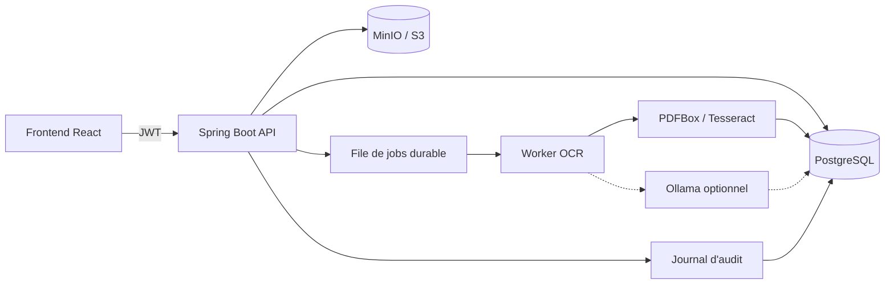
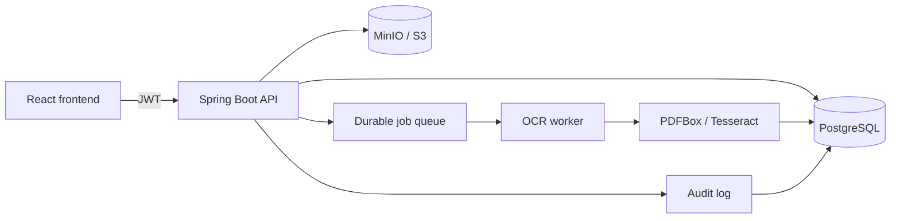

<div align="center">
  <h1>Document Extraction API</h1>
  <p><strong>API on-premise multi-utilisateurs pour l'extraction de texte PDF/image — OCR français, anglais et arabe.</strong></p>

  
  
  
  
  
  

  <p>
    <a href="#français">Français</a> ·
    <a href="#english">English</a>
  </p>
</div>

---

## Français

### Présentation

API REST Spring Boot conçue pour un déploiement **on-premise d'abord**, avec une
architecture prête pour le SaaS. Elle extrait le texte de PDF natifs, de PDF
scannés et d'images avec **Tesseract 5**, sans cloud ni modèle de vision. Une
extraction de champs par **LLM local Ollama** peut compléter les règles
déterministes lorsqu'elle est explicitement activée ; elle est désactivée par
défaut.

La V1 ajoute le socle professionnel attendu d'un produit commercial :

- comptes locaux, JWT, organisations et rôles, gestion des utilisateurs par l'admin ;
- historique et recherche côté serveur, changement de mot de passe ;
- files de traitement durables avec reprise après redémarrage ;
- stockage des fichiers source sur disque ou dans MinIO/S3 ;
- journal d'audit et politique de rétention configurable.

### Fonctionnalités V1

- **Authentification locale** : email/mot de passe, BCrypt, JWT signé, session
  sans état.
- **Rôles** : `ADMIN`, `REVIEWER`, `USER`.
  - `ADMIN` gère les comptes et voit l'historique de l'organisation ;
  - `REVIEWER` voit l'historique de l'organisation ;
  - `USER` ne voit que ses propres documents.
- **Gestion des comptes** : création par un administrateur, attribution des rôles,
  activation/désactivation et changement de mot de passe par chaque utilisateur.
  Un administrateur ne peut pas retirer ses propres droits.
- **Organisations** : chaque document, utilisateur et événement d'audit est
  rattaché à une organisation.
- **Extraction asynchrone durable** : l'upload renvoie `202 Accepted`, un worker
  revendique le job en base, le traite et met à jour le statut. Les jobs
  interrompus sont récupérés après redémarrage.
- **PDF et images** : PDF, PNG, JPEG, TIFF, BMP, WEBP ; 50 Mo et 50 pages
  maximum par défaut.
- **OCR français, anglais, arabe** (`fra`, `eng`, `ara`) avec support RTL,
  normalisation Unicode et passes multi-schémas.
- **Historique serveur** : liste paginée, recherche par nom ou contenu, filtre
  par statut.
- **Aperçu et téléchargement** : fichier source authentifié, résultat TXT ou
  JSON.
- **Champs traçables** : `reference_number` et `document_date` détectés par des
  règles déterministes, complétés en option par un LLM local Ollama pour les clés
  manquantes ; source page/ligne avec bbox normalisée, statuts `VERIFIED` /
  `UNVERIFIED` / `AMBIGUOUS` et corrections append-only propagées à toute la
  lignée du document.
- **Annulation/suppression** : suppression du document, du fichier source et du
  job associé.
- **Audit** : connexion, gestion des comptes, changement de mot de passe, création,
  suppression et purge de rétention.
- **Rétention** : 30 jours par défaut, configurable via `RETENTION_DAYS`.
- **Deux bases** : H2 fichier pour le développement local, PostgreSQL en
  production avec migrations Flyway.
- **Deux stockages** : disque local par défaut, MinIO/S3 via
  `STORAGE_TYPE=s3`.
- **IA générative locale optionnelle** : Ollama (`llama3.2:1b` par défaut),
  désactivé par défaut, sans secret ni service cloud.

### IA intégrée et technologies

L'API combine deux usages de l'IA, tous deux **locaux** :

- **OCR** : **Tesseract 5**, moteur à réseaux de neurones **LSTM**, via
  **Tess4J 5.13.0**, pour les PDF scannés et les images en français, anglais et
  arabe ;
- **Extraction de champs** : **Ollama** (`llama3.2:1b` par défaut), appelé
  uniquement pour les clés que les règles déterministes n'ont pas trouvées.

Aucun service cloud, aucun embedding et aucun `pgvector` ne sont utilisés. Une
valeur IA n'est acceptée que si elle apparaît **verbatim** dans le texte extrait,
sur une ligne avec un libellé reconnu ou seule ; sinon elle est ignorée ou
marquée `UNVERIFIED`. Aucune géométrie n'est inventée.

| Technologie | Version | Usage |
| --- | --- | --- |
| Tesseract 5 (LSTM) | Tess4J 5.13.0 | OCR local FR/EN/AR, support RTL |
| Apache PDFBox | 3.0.5 | Extraction du texte natif, rendu et positions des lignes |
| Ollama | 0.35+ (testé) | Extraction IA locale optionnelle des champs manquants |
| llama3.2:1b | — | Modèle local par défaut |
| Spring Boot | 3.3.13 | API REST, worker, sécurité, audit |
| Java | 21 | Runtime cible et CI |
| PostgreSQL 16 / H2 | — | Production et tests (mode PostgreSQL) |
| Flyway | — | Migrations additives, dont `V3__field_traceability.sql` |
| MinIO / S3 | — | Stockage des fichiers source |
| Données Tesseract | — | Modèles linguistiques locaux `fra`, `eng`, `ara` |

### Extraction IA locale avec Ollama (optionnelle)

Le mode est **déterministe d'abord** : Ollama ne remplace jamais un champ trouvé
par une règle et une panne du modèle ne fait pas échouer le document.

```bash
ollama pull llama3.2:1b
curl http://localhost:11434/api/tags
export OLLAMA_ENABLED=true
export OLLAMA_BASE_URL=http://localhost:11434
export OLLAMA_MODEL=llama3.2:1b
mvn spring-boot:run
```

Sous Windows, utilisez `$env:OLLAMA_ENABLED = "true"` et `mvn.cmd`.
En Docker, l'API joint l'hôte via `http://host.docker.internal:11434` ;
`docker-compose.yml` ajoute `host.docker.internal:host-gateway` pour Linux. Si
Ollama tourne sur l'hôte, démarrez-le avec `OLLAMA_HOST=0.0.0.0:11434`.

Une valeur IA absente du texte est rejetée ; une date non parsable est ignorée ;
une date ambiguë reste `AMBIGUOUS`. Le test réel est opt-in :
`OLLAMA_LIVE_TEST=true mvn -Dtest=OllamaLiveTest test`.

### Durcissement V1.1

- **Politique de mot de passe** : 12 à 128 caractères pour la création, le
  changement et la réinitialisation par un administrateur.
- **Révocation des sessions** : changement de mot de passe, déconnexion ou
  réinitialisation admin incrémente `users.token_version` ; les anciens JWT sont
  rejetés immédiatement.
- **Anti-bruteforce** : limitation des connexions en base, clé email normalisé +
  IP ; 5 tentatives, fenêtre de 15 minutes et blocage de 15 minutes par défaut.
- **Profil utilisateur** : modification du nom d'affichage et réinitialisation
  admin du mot de passe d'un compte.
- **Garde de production** : les profils `postgres` et `prod` refusent de démarrer
  avec les secrets de démonstration.
- **Exploitation** : stack Compose complète frontend + API + PostgreSQL + MinIO,
  TLS et Prometheus optionnels, scripts de sauvegarde/restauration.
- **Validation** : suite backend et frontend, parcours E2E Playwright, benchmark
  OCR synthétique FR/EN/AR.

> Déploiement, TLS et sauvegardes : [DEPLOYMENT.md](DEPLOYMENT.md). Checklist de
> sécurité : [SECURITY.md](SECURITY.md).

### Architecture



Le front et l'API sont **deux applications distinctes réunies dans ce dépôt**
(`document-extraction-front-end/` et `document-extraction-api/`). Le front peut être servi par nginx et
proxyfier `/api/v1/` vers cette API.

### Stack technique

| Domaine | Choix |
| --- | --- |
| Runtime | Java 21, Spring Boot 3.3 |
| Sécurité | Spring Security, JWT (JJWT), BCrypt |
| Base | PostgreSQL 16 (prod), H2 fichier (local), Flyway |
| Stockage | Disque local ou MinIO / S3 |
| OCR | Tesseract 5, Tess4J, Leptonica |
| Extraction IA (option) | Ollama `llama3.2:1b`, client HTTP JDK |
| PDF | Apache PDFBox 3 |
| Détection MIME | Apache Tika 3 |
| File de jobs | Table `jobs` PostgreSQL, verrouillage transactionnel |
| Documentation | Springdoc OpenAPI / Swagger UI |
| Build | Maven 3.9, Docker multi-stage |

### Démarrage rapide — local sans Docker

Prérequis : **JDK 21**, **Maven 3.9+**, **Tesseract 5** avec `fra`, `eng`, `ara`.

```bash
# Vérifier les langues Tesseract
tesseract --list-langs

# Lancer l'API (H2 fichier + stockage disque local)
export TESSDATA_PREFIX=/usr/share/tesseract-ocr/5/tessdata
mvn spring-boot:run
```

Sous Windows :

```powershell
$env:TESSDATA_PREFIX = "C:\Program Files\Tesseract-OCR\tessdata"
mvn.cmd spring-boot:run
```

Au premier démarrage, un administrateur et une organisation sont créés si la base
est vide :

| Paramètre | Valeur par défaut |
| --- | --- |
| Email | `admin@local.test` |
| Mot de passe | `ChangeMe123!` |
| Organisation | `Mon organisation` |

> Changez immédiatement ces valeurs avec `BOOTSTRAP_ADMIN_PASSWORD` et
> `BOOTSTRAP_ADMIN_EMAIL` avant toute mise en production.

Services locaux :

- API : `http://localhost:8080`
- Swagger UI : `http://localhost:8080/swagger-ui.html`
- Santé : `http://localhost:8080/actuator/health`
- Données locales : `./data/db` et `./data/storage`

### Démarrage Docker — PostgreSQL + MinIO

```bash
cp .env.example .env
# Éditer .env : secrets aléatoires, JWT_SECRET, compte administrateur
docker compose up --build -d
docker compose logs -f document-extraction-api
```

Le Compose démarre une stack complète :

- PostgreSQL 16 ;
- MinIO (API sur `http://localhost:9000`, console sur `http://localhost:9001`) ;
- un conteneur d'initialisation du bucket ;
- l'API sur `http://localhost:${API_PORT:-8080}` ;
- le frontend sur `http://localhost:${FRONTEND_PORT:-8081}`.

Le profil Spring `postgres` est activé automatiquement. Les fichiers sont stockés
dans MinIO, les métadonnées et résultats dans PostgreSQL.

Le frontend est construit depuis le dossier voisin `../document-extraction-front-end` par défaut
(`FRONTEND_CONTEXT`). En production, pinnez
`MINIO_IMAGE` par digest : les images MinIO officielles ne sont plus publiées et
le miroir `elestio/minio` par défaut doit être vérifié par votre organisation.
Voir [DEPLOYMENT.md](DEPLOYMENT.md) pour TLS, Prometheus, sauvegarde et
restauration.

### Authentification et rôles

```bash
# Connexion
curl -X POST http://localhost:8080/api/v1/auth/login \
  -H "Content-Type: application/json" \
  -d '{"email":"admin@local.test","password":"ChangeMe123!"}'
```

La réponse contient `accessToken`, `tokenType`, `expiresInSeconds` et `user`.
Envoyez ensuite :

```bash
-H "Authorization: Bearer <accessToken>"
```

Les mots de passe doivent contenir **12 à 128 caractères**. Un changement de mot
de passe, une déconnexion ou une réinitialisation par un administrateur révoque
les JWT existants. Les tentatives de connexion sont limitées par email + IP
(5 essais / 15 minutes / blocage 15 minutes par défaut).

| Rôle | Portée |
| --- | --- |
| `ADMIN` | Toute l'organisation, gestion des comptes, audit |
| `REVIEWER` | Toute l'organisation, relecture et historique |
| `USER` | Ses propres documents uniquement |

```bash
# Créer un utilisateur (admin)
curl -X POST http://localhost:8080/api/v1/users \
  -H "Authorization: Bearer $TOKEN" \
  -H "Content-Type: application/json" \
  -d '{"email":"reviewer@organisation.dz","displayName":"Revue Documentaire","password":"ReviewerPass123!","role":"REVIEWER"}'

# Changer son propre mot de passe
curl -X POST http://localhost:8080/api/v1/auth/password \
  -H "Authorization: Bearer $TOKEN" \
  -H "Content-Type: application/json" \
  -d '{"currentPassword":"ChangeMe123!","newPassword":"NouveauPass123!"}'
```

### API principale

Base : `http://localhost:8080/api/v1`.

| Méthode | Chemin | Rôle |
| --- | --- | --- |
| `POST` | `/auth/login` | Connexion, retourne un JWT |
| `GET` | `/auth/me` | Profil courant |
| `PATCH` | `/auth/me` | Modifie le nom d'affichage |
| `POST` | `/auth/password` | Change le mot de passe courant |
| `POST` | `/auth/logout` | Révoque la session courante |
| `GET` | `/users` | Liste les comptes de l'organisation (admin) |
| `POST` | `/users` | Crée un compte (admin) |
| `PATCH` | `/users/{id}` | Change le rôle ou l'activation (admin) |
| `POST` | `/users/{id}/password` | Réinitialise le mot de passe (admin) |
| `POST` | `/extractions` | Crée une extraction (multipart), `202` |
| `GET` | `/extractions/{id}` | Statut et résultat |
| `GET` | `/extractions/{id}/file` | Fichier source authentifié |
| `GET` | `/extractions/{id}/download?format=txt\|json` | Résultat |
| `GET` | `/extractions/{id}/fields` | Champs, sources et corrections |
| `POST` | `/extractions/{id}/fields/{fieldKey}/corrections` | Correction append-only |
| `DELETE` | `/extractions/{id}` | Supprime le document |
| `GET` | `/documents` | Historique, recherche, pagination |
| `DELETE` | `/documents` | Vide vos propres documents |
| `GET` | `/audit` | Journal d'audit (admin) |

#### Upload et polling

```bash
TOKEN="<accessToken>"

curl -X POST http://localhost:8080/api/v1/extractions \
  -H "Authorization: Bearer $TOKEN" \
  -F "file=@facture.pdf" \
  -F "languages=fra+eng"
```

Réponse `202 Accepted` :

```json
{
  "id": "0f7d4c8e-5b0f-4c7e-9e2a-2a3b4c5d6e7f",
  "status": "PENDING",
  "fileName": "facture.pdf",
  "mimeType": "application/pdf",
  "pageCount": 2,
  "fullText": "",
  "pages": [],
  "durationMs": 0,
  "error": null,
  "createdAt": "2026-10-27T08:00:00Z",
  "languages": "fra+eng"
}
```

```bash
curl -H "Authorization: Bearer $TOKEN" \
  http://localhost:8080/api/v1/extractions/<id>
```

Statuts : `PENDING`, `PROCESSING`, `COMPLETED`, `FAILED`, `CANCELLED`.

Les champs structurés séparent la valeur brute, la valeur normalisée (réservée à
la comparaison) et la valeur effective (dernière correction de la lignée, sinon
valeur brute). Une valeur sans source fiable est `UNVERIFIED` ; une date dont
l'ordre jour/mois ou le calendrier n'est pas prouvé est `AMBIGUOUS`. Les
corrections sont append-only et ne modifient jamais la valeur brute. Les exports
TXT/JSON utilisent le même service que l'API ; le JSON est additif
(`schema_version`, `fields`).

L'extraction est **déterministe d'abord**. Si `OLLAMA_ENABLED=true`, un LLM
local complète uniquement les clés manquantes ; il ne remplace jamais une valeur
déterministe. Une valeur IA doit correspondre à un span vérifiable, sinon elle
est `UNVERIFIED` ou rejetée. Aucun `pgvector` n'est utilisé. Les champs sont
extraits avant la persistance de `COMPLETED` : lorsqu'un client voit ce statut,
`GET /fields` renvoie déjà le résultat complet.

#### Traçabilité des champs — état d'implémentation

| Composant | État | Détail |
| --- | --- | --- |
| Schéma | ✅ | `V3__field_traceability.sql` : lignée, champs, sources et corrections |
| Règles | ✅ | `FieldRule`, `ReferenceNumberRule`, `DocumentDateRule` |
| Spans | ✅ | Ligne, bbox `[x0,y0,x1,y1]` normalisée, dimensions et rotation de page |
| Normalisation | ✅ | NFC + repli des chiffres arabes/persans pour la comparaison uniquement |
| API | ✅ | `GET /fields`, `POST /fields/{fieldKey}/corrections` |
| Exports | ✅ | `ExtractionExportService` partagé, JSON additif |
| Sécurité | ✅ | Filtrage `organization_id`, accès vérifié, audit `FIELD_CORRECTED` |
| Tests | ✅ | Unités + intégration lignée, corrections et exports |

Les décisions sont détaillées dans
[`../docs/adr/0001-field-traceability.md`](../docs/adr/0001-field-traceability.md)
et [`../docs/adr/0002-ollama-field-extraction.md`](../docs/adr/0002-ollama-field-extraction.md),
et l'état complet dans
[`../docs/implementation-status.md`](../docs/implementation-status.md).

#### Historique et recherche

```bash
curl -G http://localhost:8080/api/v1/documents \
  -H "Authorization: Bearer $TOKEN" \
  --data-urlencode "query=facture" \
  --data-urlencode "status=COMPLETED" \
  --data-urlencode "page=0" \
  --data-urlencode "size=20"
```

### Configuration

Toutes les variables peuvent être surchargées par l'environnement. Un exemple
complet est fourni dans `.env.example`.

| Variable | Défaut | Description |
| --- | --- | --- |
| `SPRING_PROFILES_ACTIVE` | vide | `postgres` (Compose) ou `prod` pour la production |
| `DATABASE_URL` | H2 fichier | URL JDBC |
| `DATABASE_USERNAME` / `DATABASE_PASSWORD` | `sa` / vide | Identifiants JDBC |
| `JWT_SECRET` | secret de dev | **32 octets minimum**, obligatoire en production |
| `JWT_TTL_MINUTES` | `480` | Durée du token |
| `LOGIN_MAX_ATTEMPTS` / `LOGIN_WINDOW_MINUTES` / `LOGIN_BLOCK_MINUTES` | `5` / `15` / `15` | Limitation des connexions |
| `BOOTSTRAP_ENABLED` | `true` | Crée le premier compte si la base est vide |
| `BOOTSTRAP_ADMIN_EMAIL` | `admin@local.test` | Email administrateur initial |
| `BOOTSTRAP_ADMIN_PASSWORD` | `ChangeMe123!` | Mot de passe initial — à changer |
| `STORAGE_TYPE` | `local` | `local` ou `s3` |
| `STORAGE_LOCAL_PATH` | `./data/storage` | Racine du stockage disque |
| `MINIO_ENDPOINT` | `http://localhost:9000` | Endpoint S3/MinIO |
| `MINIO_ACCESS_KEY` / `MINIO_SECRET_KEY` | `minioadmin` | Identifiants S3 |
| `MINIO_BUCKET` | `document-extraction` | Bucket |
| `RETENTION_DAYS` | `30` | Purge automatique ; `0` désactive |
| `QUEUE_WORKER_ENABLED` | `true` | Active le worker de traitement |
| `QUEUE_POLL_INTERVAL_MS` | `1500` | Fréquence de polling du worker |
| `QUEUE_MAX_ATTEMPTS` | `3` | Tentatives en cas d'erreur transitoire |
| `MAX_FILE_SIZE_BYTES` | `52428800` | 50 Mo |
| `MAX_PAGES` | `50` | Pages PDF / images |
| `PDF_DPI` | `300` | Rendu PDF avant OCR |
| `OCR_DEFAULT_LANGUAGES` | `fra+eng` | Langues par défaut |
| `TESSDATA_PREFIX` | chemin système | Données Tesseract |
| `OLLAMA_ENABLED` | `false` | Active l'extraction IA locale des champs manquants |
| `OLLAMA_BASE_URL` | `http://localhost:11434` | Endpoint Ollama (Docker : `http://host.docker.internal:11434`) |
| `OLLAMA_MODEL` | `llama3.2:1b` | Modèle local déjà téléchargé |
| `OLLAMA_TIMEOUT_SECONDS` | `120` | Délai maximal par appel |
| `OLLAMA_MAX_INPUT_CHARACTERS` | `12000` | Troncature du texte envoyé |
| `OLLAMA_NUM_PREDICT` | `256` | Tokens générés au maximum |
| `OLLAMA_NUM_CTX` | `8192` | Fenêtre de contexte |
| `OLLAMA_KEEP_ALIVE` | `5m` | Durée de résidence du modèle |
| `CORS_ALLOWED_ORIGIN` | `http://localhost:5173` | Origine front autorisée ; Compose utilise `8081` |
| `API_PORT` / `FRONTEND_PORT` | `8080` / `8081` | Ports hôte Compose |
| `FRONTEND_CONTEXT` | `../document-extraction-front-end` | Dépôt frontend pour le build Compose |
| `MINIO_IMAGE` | `elestio/minio:latest` | Miroir MinIO ; pin par digest en production |

### Rétention et audit

- Chaque document reçoit `retention_until = created_at + RETENTION_DAYS`.
- Une tâche horaire supprime les fichiers expirés et les lignes associées.
- Les événements d'audit conservent l'action, l'acteur, l'IP, le user-agent et
  l'identifiant du document.
- En production, sauvegardez PostgreSQL et MinIO ensemble pour garder un état
  cohérent.

### Tests

```bash
mvn test
mvn -B package
mvn -B verify
```

La suite couvre la détection MIME, PDFBox, le prétraitement, l'OCR, la
normalisation arabe, le contrôleur, l'authentification, la révocation JWT, la
limitation des connexions, la persistance, la file durable, le worker, le cycle
de vie documentaire, les règles de champs et l'extraction IA Ollama (client HTTP
simulé, validation des spans et des dates). Le test contre une instance Ollama
réelle est ignoré sauf si `OLLAMA_LIVE_TEST=true`.

Dernier benchmark synthétique V1.1 : FR `0.00 %` CER / `0.00 %` WER, EN
`0.00 %` / `0.00 %`, AR `3.61 %` / `4.35 %` ; agrégat `1.34 %` CER /
`1.41 %` WER. Ces chiffres ne constituent pas une acceptance client.

Le benchmark OCR s'exécute avec l'image Docker et écrit ses résultats :

```bash
docker compose build document-extraction-api
node ./benchmark/run.mjs
```

Voir [benchmark/README.md](benchmark/README.md). Le corpus fourni est synthétique :
il valide la chaîne et les trois langues, pas la précision sur un corpus client.
Les parcours E2E Playwright sont dans le dépôt frontend et nécessitent la stack
Compose démarrée.

### Sécurité — checklist de mise en production

La checklist complète est dans [SECURITY.md](SECURITY.md). Points minimum :

- [ ] Remplacer tous les secrets d'exemple par des valeurs aléatoires.
- [ ] Définir `JWT_SECRET` (32 octets minimum) et un mot de passe admin de 12+
  caractères.
- [ ] Utiliser des identifiants PostgreSQL et MinIO dédiés.
- [ ] Épingler `MINIO_IMAGE` par digest après revue de la chaîne d'approvisionnement.
- [ ] Terminer TLS devant le front et l'API ; rediriger HTTP vers HTTPS.
- [ ] Restreindre `CORS_ALLOWED_ORIGIN` à l'origine publique.
- [ ] Restreindre l'accès réseau à PostgreSQL, MinIO, Prometheus et au port API.
- [ ] Configurer et tester les sauvegardes PostgreSQL + MinIO.
- [ ] Ajuster `RETENTION_DAYS` à la politique de l'organisation.
- [ ] Surveiller `/actuator/health`, `/actuator/prometheus`, les erreurs du worker
  et l'espace disque.
- [ ] Revoir le journal d'audit et les tentatives de connexion échouées.

### Limites et feuille de route

- Tesseract n'est **pas un moteur d'écriture manuscrite** : l'arabe manuscrit
  reste en meilleur effort.
- V1 utilise une file durable en base plutôt que Redis ; Redis/une file
  distribuée pourra être ajouté lorsque le volume le justifiera.
- Authentification locale uniquement : SSO, facturation et quotas par
  organisation sont prévus pour les versions suivantes.
- Les tableaux complexes et l'ordre de lecture peuvent encore être imparfaits.
- La prévisualisation TIFF dépend du navigateur ; un message de repli et le
  téléchargement du fichier original sont fournis.
- Le benchmark OCR fourni est synthétique. Une acceptance réelle exige un corpus
  client anonymisé et approuvé pour le test.
- Les images MinIO officielles ne sont plus publiées ; le miroir par défaut doit
  être vérifié et épinglé, ou remplacé par un stockage S3 géré.
- **Traçabilité** : seuls `reference_number` et `document_date` sont extraits ;
  les spans sont au niveau ligne ; la dernière correction fait foi (pas de
  validation à quatre yeux ni de suppression) ; l'IA locale Ollama est
  optionnelle et désactivée par défaut ; aucun `pgvector`.

### Structure

```text
src/main/java/dz/DocuScan/document/
  ai/           client HTTP Ollama et propriétés de l'IA locale
  config/       propriétés, CORS, stockage
  controller/   auth, documents, extractions, users, audit
  dto/          réponses API
  exception/    ProblemDetail
  extractor/    PDFBox, Tesseract, prétraitement
  field/        règles déterministes, extracteur Ollama et normalisation
  model/        utilisateur, rôle, job, statut
  repository/   JDBC, documents, jobs, audit, utilisateurs
  security/     JWT, filtre, Spring Security
  service/      auth, utilisateurs, extraction, stockage, worker, rétention, audit
src/main/resources/db/migration/  schéma Flyway
src/test/java/                    tests unitaires et d'intégration
benchmark/                        corpus synthétique et harness CER/WER
deploy/                           TLS nginx et Prometheus
scripts/                          sauvegarde et restauration
tessdata/                         données Tesseract locales (ignoré par Git)
docker-compose.yml                frontend + API + PostgreSQL + MinIO
DEPLOYMENT.md                     déploiement, TLS, sauvegarde, restauration
SECURITY.md                       contrôles et checklist de sécurité
```

### Licence

Ce projet est distribué sous **licence propriétaire DocuScan — tous droits
réservés**. Toute reproduction, modification, distribution ou utilisation
commerciale nécessite une autorisation écrite préalable. Voir le fichier
[`../LICENSE`](../LICENSE).

---

## English

### Overview

Spring Boot REST API built **on-premise first** and ready for a SaaS evolution.
It extracts text from native PDFs, scanned PDFs and images with **Tesseract 5**,
without cloud OCR or a vision model. Field extraction with a **local Ollama LLM**
can complement the deterministic rules when explicitly enabled; it is disabled by
default.

V1 adds the professional foundation of a commercial product:

- local accounts, JWT, organizations and roles, admin-managed users;
- server-side history and search, self-service password change;
- durable job queues with restart recovery;
- source-file storage on disk or MinIO/S3;
- audit log and configurable retention.

### V1 features

- **Local authentication**: email/password, BCrypt, signed JWT, stateless
  sessions.
- **Roles**: `ADMIN`, `REVIEWER`, `USER`.
  - `ADMIN` manages accounts and sees the organization history;
  - `REVIEWER` sees the organization history;
  - `USER` sees only owned documents.
- **Account management**: admin-created accounts, role assignment,
  activation/deactivation and per-user password changes. An administrator cannot
  remove their own admin rights.
- **Organizations**: every document, user and audit event belongs to an
  organization.
- **Durable asynchronous extraction**: upload returns `202 Accepted`; a worker
  claims the job in the database, processes it and updates the status. Stuck jobs
  are recovered after a restart.
- **PDF and images**: PDF, PNG, JPEG, TIFF, BMP, WEBP; 50 MB and 50 pages by
  default.
- **French, English and Arabic OCR** (`fra`, `eng`, `ara`) with RTL support,
  Unicode normalization and multi-script passes.
- **Server history**: paginated list, search by name or content, status filter.
- **Preview and download**: authenticated source file, TXT or JSON result.
- **Traceable fields**: `reference_number` and `document_date` detected by
  deterministic rules, optionally complemented by a local Ollama LLM for missing
  keys; page/line source with a normalized bbox, `VERIFIED` / `UNVERIFIED` /
  `AMBIGUOUS` statuses and append-only corrections propagated across the
  document lineage.
- **Cancel/delete**: removes the document, source file and associated job.
- **Audit**: login, account management, password changes, creation, deletion and
  retention purge.
- **Retention**: 30 days by default, configurable with `RETENTION_DAYS`.
- **Two databases**: file-based H2 for local development, PostgreSQL in
  production with Flyway migrations.
- **Two storage backends**: local disk by default, MinIO/S3 with
  `STORAGE_TYPE=s3`.
- **Optional local generative AI**: Ollama (`llama3.2:1b` by default), disabled
  by default, with no secret or cloud service.

### Integrated AI and technologies

The API combines two AI uses, both **local**:

- **OCR**: **Tesseract 5**, an **LSTM** neural OCR engine, through
  **Tess4J 5.13.0**, for scanned PDFs and images in French, English and Arabic;
- **Field extraction**: **Ollama** (`llama3.2:1b` by default), called only for
  keys the deterministic rules did not produce.

No cloud service, embedding or `pgvector` is used. An AI value is accepted only
when it appears **verbatim** in the extracted text, on a recognized-label line or
alone; otherwise it is discarded or marked `UNVERIFIED`. No geometry is invented.

| Technology | Version | Purpose |
| --- | --- | --- |
| Tesseract 5 (LSTM) | Tess4J 5.13.0 | Local FR/EN/AR OCR, RTL support |
| Apache PDFBox | 3.0.5 | Native text extraction, rendering and line positions |
| Ollama | 0.35+ (tested) | Optional local AI extraction of missing fields |
| llama3.2:1b | — | Default local model |
| Spring Boot | 3.3.13 | REST API, worker, security, audit |
| Java | 21 | Target runtime and CI |
| PostgreSQL 16 / H2 | — | Production and tests (PostgreSQL mode) |
| Flyway | — | Additive migrations, including `V3__field_traceability.sql` |
| MinIO / S3 | — | Source file storage |
| Tesseract data | — | Local `fra`, `eng`, `ara` language models |

### Optional local AI extraction with Ollama

The mode is **deterministic first**: Ollama never replaces a field found by a
rule, and a model outage never fails the document.

```bash
ollama pull llama3.2:1b
curl http://localhost:11434/api/tags
export OLLAMA_ENABLED=true
export OLLAMA_BASE_URL=http://localhost:11434
export OLLAMA_MODEL=llama3.2:1b
mvn spring-boot:run
```

On Windows, use `$env:OLLAMA_ENABLED = "true"` and `mvn.cmd`.
In Docker, the API reaches the host through
`http://host.docker.internal:11434`; `docker-compose.yml` adds
`host.docker.internal:host-gateway` for Linux. When Ollama runs on the host,
start it with `OLLAMA_HOST=0.0.0.0:11434`.

An AI value absent from the text is rejected; an unparsable date is discarded; an
ambiguous date remains `AMBIGUOUS`. The real test is opt-in:
`OLLAMA_LIVE_TEST=true mvn -Dtest=OllamaLiveTest test`.

### V1.1 hardening

- **Password policy**: 12–128 characters for account creation, self-service
  changes and admin resets.
- **Session revocation**: password change, logout and admin reset increment
  `users.token_version`; existing JWTs are rejected immediately.
- **Login throttling**: database-backed, keyed by normalized email + IP; defaults
  are 5 attempts, a 15-minute window and a 15-minute block.
- **Profile management**: users edit their display name; admins reset another
  user's password.
- **Production guard**: `postgres` and `prod` profiles refuse default demo secrets
  at startup.
- **Operations**: one Compose stack for frontend, API, PostgreSQL and MinIO;
  optional TLS and Prometheus profiles; backup and restore scripts.
- **Validation**: backend/frontend suites, Playwright E2E flows and a synthetic
  FR/EN/AR OCR benchmark.

> Deployment, TLS and backups: [DEPLOYMENT.md](DEPLOYMENT.md). Security checklist:
> [SECURITY.md](SECURITY.md).

### Architecture



The frontend and API are **two distinct applications combined in this repository**
(`document-extraction-front-end/` and `document-extraction-api/`). The frontend can be served by nginx
and proxy `/api/v1/` to this API.

### Quick start — local without Docker

Requirements: **JDK 21**, **Maven 3.9+**, **Tesseract 5** with `fra`, `eng`,
`ara`.

```bash
tesseract --list-langs
export TESSDATA_PREFIX=/usr/share/tesseract-ocr/5/tessdata
mvn spring-boot:run
```

Windows:

```powershell
$env:TESSDATA_PREFIX = "C:\Program Files\Tesseract-OCR\tessdata"
mvn.cmd spring-boot:run
```

On first start, an administrator and organization are created if the database is
empty:

| Setting | Default |
| --- | --- |
| Email | `admin@local.test` |
| Password | `ChangeMe123!` |
| Organization | `Mon organisation` |

> Change these values with `BOOTSTRAP_ADMIN_PASSWORD` and
> `BOOTSTRAP_ADMIN_EMAIL` before production.

Local services:

- API: `http://localhost:8080`
- Swagger UI: `http://localhost:8080/swagger-ui.html`
- Health: `http://localhost:8080/actuator/health`
- Local data: `./data/db` and `./data/storage`

### Docker — PostgreSQL + MinIO

```bash
cp .env.example .env
# Edit .env: random secrets, JWT_SECRET, administrator account
docker compose up --build -d
docker compose logs -f document-extraction-api
```

Compose starts the full stack: PostgreSQL 16, MinIO (API `http://localhost:9000`,
console `http://localhost:9001`), a bucket initializer, the API on
`http://localhost:${API_PORT:-8080}` and the frontend on
`http://localhost:${FRONTEND_PORT:-8081}`. The `postgres` Spring profile is
enabled automatically.

The frontend is built from the sibling folder `../document-extraction-front-end` by default
(`FRONTEND_CONTEXT`). For production, pin
`MINIO_IMAGE` by digest: official MinIO images are no longer published, and the
default `elestio/minio` mirror must be reviewed by your organization. See
[DEPLOYMENT.md](DEPLOYMENT.md) for TLS, Prometheus, backup and restore.

### Authentication and roles

```bash
curl -X POST http://localhost:8080/api/v1/auth/login \
  -H "Content-Type: application/json" \
  -d '{"email":"admin@local.test","password":"ChangeMe123!"}'
```

Then send `Authorization: Bearer <accessToken>` on protected endpoints.

Passwords must contain **12–128 characters**. A password change, logout or admin
reset revokes existing JWTs. Login attempts are throttled by normalized email +
IP (5 attempts / 15-minute window / 15-minute block by default).

| Role | Scope |
| --- | --- |
| `ADMIN` | Entire organization, account management, audit |
| `REVIEWER` | Entire organization, review and history |
| `USER` | Own documents only |

```bash
# Create a user (admin)
curl -X POST http://localhost:8080/api/v1/users \
  -H "Authorization: Bearer $TOKEN" \
  -H "Content-Type: application/json" \
  -d '{"email":"reviewer@organization.com","displayName":"Document Reviewer","password":"ReviewerPass123!","role":"REVIEWER"}'

# Change your own password
curl -X POST http://localhost:8080/api/v1/auth/password \
  -H "Authorization: Bearer $TOKEN" \
  -H "Content-Type: application/json" \
  -d '{"currentPassword":"ChangeMe123!","newPassword":"NewPassword123!"}'
```

### Main API

Base URL: `http://localhost:8080/api/v1`.

| Method | Path | Purpose |
| --- | --- | --- |
| `POST` | `/auth/login` | Sign in, returns a JWT |
| `GET` | `/auth/me` | Current profile |
| `PATCH` | `/auth/me` | Update display name |
| `POST` | `/auth/password` | Change the current password |
| `POST` | `/auth/logout` | Revoke the current session |
| `GET` | `/users` | List organization accounts (admin) |
| `POST` | `/users` | Create an account (admin) |
| `PATCH` | `/users/{id}` | Change role or activation (admin) |
| `POST` | `/users/{id}/password` | Reset a password (admin) |
| `POST` | `/extractions` | Create an extraction (multipart), `202` |
| `GET` | `/extractions/{id}` | Status and result |
| `GET` | `/extractions/{id}/file` | Authenticated source file |
| `GET` | `/extractions/{id}/download?format=txt\|json` | Result download |
| `GET` | `/extractions/{id}/fields` | Fields, sources and corrections |
| `POST` | `/extractions/{id}/fields/{fieldKey}/corrections` | Append-only correction |
| `DELETE` | `/extractions/{id}` | Delete a document |
| `GET` | `/documents` | History, search, pagination |
| `DELETE` | `/documents` | Clear your own documents |
| `GET` | `/audit` | Audit log (admin) |

Statuses: `PENDING`, `PROCESSING`, `COMPLETED`, `FAILED`, `CANCELLED`.

Structured fields separate the raw value, the normalized value (comparison only)
and the effective value (latest correction in the lineage, otherwise the raw
value). A value without a reliable source is `UNVERIFIED`; a date whose
day/month order or calendar cannot be proven is `AMBIGUOUS`. Corrections are
append-only and never modify the raw value. TXT/JSON exports use the same service
as the API; JSON is additive (`schema_version`, `fields`).

Extraction is **deterministic first**. When `OLLAMA_ENABLED=true`, a local LLM
only fills missing keys; it never replaces a deterministic value. An AI value
must match a verifiable span, otherwise it is `UNVERIFIED` or discarded. No
`pgvector` is used. Fields are extracted before the `COMPLETED` snapshot is
persisted, so `GET /fields` already returns the full result when a client sees
that status.

#### Field traceability — implementation status

| Component | Status | Detail |
| --- | --- | --- |
| Schema | ✅ | `V3__field_traceability.sql`: lineage, fields, sources and corrections |
| Rules | ✅ | `FieldRule`, `ReferenceNumberRule`, `DocumentDateRule` |
| Spans | ✅ | Line-level, normalized `[x0,y0,x1,y1]` bbox, page dimensions and rotation |
| Normalization | ✅ | NFC + Arabic-Indic/Persian digit folding for comparison only |
| API | ✅ | `GET /fields`, `POST /fields/{fieldKey}/corrections` |
| Exports | ✅ | Shared `ExtractionExportService`, additive JSON |
| Security | ✅ | `organization_id` filtering, access checks, `FIELD_CORRECTED` audit |
| Tests | ✅ | Unit tests + lineage, correction and export integration |

Decisions are documented in
[`../docs/adr/0001-field-traceability.md`](../docs/adr/0001-field-traceability.md)
and [`../docs/adr/0002-ollama-field-extraction.md`](../docs/adr/0002-ollama-field-extraction.md),
and the complete status in
[`../docs/implementation-status.md`](../docs/implementation-status.md).

### Configuration

All values can be overridden by environment variables; see `.env.example`.

| Variable | Default | Description |
| --- | --- | --- |
| `SPRING_PROFILES_ACTIVE` | empty | `postgres` (Compose) or `prod` for production |
| `DATABASE_URL` | H2 file | JDBC URL |
| `DATABASE_USERNAME` / `DATABASE_PASSWORD` | `sa` / empty | JDBC credentials |
| `JWT_SECRET` | dev secret | **At least 32 bytes**, required in production |
| `JWT_TTL_MINUTES` | `480` | Token lifetime |
| `LOGIN_MAX_ATTEMPTS` / `LOGIN_WINDOW_MINUTES` / `LOGIN_BLOCK_MINUTES` | `5` / `15` / `15` | Login throttling |
| `BOOTSTRAP_ENABLED` | `true` | Create the first account when empty |
| `BOOTSTRAP_ADMIN_EMAIL` | `admin@local.test` | Initial administrator email |
| `BOOTSTRAP_ADMIN_PASSWORD` | `ChangeMe123!` | Initial password — change it |
| `STORAGE_TYPE` | `local` | `local` or `s3` |
| `STORAGE_LOCAL_PATH` | `./data/storage` | Local storage root |
| `MINIO_ENDPOINT` | `http://localhost:9000` | S3/MinIO endpoint |
| `MINIO_ACCESS_KEY` / `MINIO_SECRET_KEY` | `minioadmin` | S3 credentials |
| `MINIO_BUCKET` | `document-extraction` | Bucket |
| `RETENTION_DAYS` | `30` | Automatic purge; `0` disables |
| `QUEUE_WORKER_ENABLED` | `true` | Enable the processing worker |
| `QUEUE_POLL_INTERVAL_MS` | `1500` | Worker polling interval |
| `QUEUE_MAX_ATTEMPTS` | `3` | Retries for transient failures |
| `MAX_FILE_SIZE_BYTES` | `52428800` | 50 MB |
| `MAX_PAGES` | `50` | PDF pages / image frames |
| `PDF_DPI` | `300` | PDF render resolution before OCR |
| `OCR_DEFAULT_LANGUAGES` | `fra+eng` | Default languages |
| `TESSDATA_PREFIX` | system path | Tesseract data |
| `OLLAMA_ENABLED` | `false` | Enable local AI extraction of missing fields |
| `OLLAMA_BASE_URL` | `http://localhost:11434` | Ollama endpoint (Docker: `http://host.docker.internal:11434`) |
| `OLLAMA_MODEL` | `llama3.2:1b` | Local model already pulled |
| `OLLAMA_TIMEOUT_SECONDS` | `120` | Per-call timeout |
| `OLLAMA_MAX_INPUT_CHARACTERS` | `12000` | Truncate text sent to the model |
| `OLLAMA_NUM_PREDICT` | `256` | Maximum generated tokens |
| `OLLAMA_NUM_CTX` | `8192` | Context window |
| `OLLAMA_KEEP_ALIVE` | `5m` | How long the model stays in memory |
| `CORS_ALLOWED_ORIGIN` | `http://localhost:5173` | Allowed frontend origin; Compose uses `8081` |
| `API_PORT` / `FRONTEND_PORT` | `8080` / `8081` | Compose host ports |
| `FRONTEND_CONTEXT` | `../document-extraction-front-end` | Frontend checkout used by the Compose build |
| `MINIO_IMAGE` | `elestio/minio:latest` | MinIO mirror; pin by digest in production |

### Retention and audit

- Each document receives `retention_until = created_at + RETENTION_DAYS`.
- An hourly task removes expired files and their database rows.
- Audit events keep the action, actor, IP, user agent and document id.
- In production, back up PostgreSQL and MinIO together to preserve a consistent
  state.

### Tests

```bash
mvn test
mvn -B package
mvn -B verify
```

The suite covers MIME detection, PDFBox, preprocessing, OCR, Arabic
normalization, the controller, authentication, JWT revocation, login throttling,
persistence, the durable queue, the worker, the document lifecycle, field rules
and Ollama AI extraction (fake HTTP client, span and date validation). The test
against a real Ollama instance is skipped unless `OLLAMA_LIVE_TEST=true`.

Latest synthetic V1.1 benchmark: FR `0.00 %` CER / `0.00 %` WER, EN
`0.00 %` / `0.00 %`, AR `3.61 %` / `4.35 %`; aggregate `1.34 %` CER /
`1.41 %` WER. These numbers are not a customer acceptance result.

Run the OCR benchmark against the Docker image:

```bash
docker compose build document-extraction-api
node ./benchmark/run.mjs
```

See [benchmark/README.md](benchmark/README.md). The corpus is synthetic: it
validates the pipeline and all three language packs, not accuracy on a customer
corpus. Playwright E2E flows live in the frontend repository and require the
Compose stack to be running.

### Production security checklist

The full checklist is in [SECURITY.md](SECURITY.md). Minimum:

- [ ] Replace every example secret with a random value.
- [ ] Set `JWT_SECRET` (32+ bytes) and a 12+ character admin password.
- [ ] Use dedicated PostgreSQL and MinIO credentials.
- [ ] Pin `MINIO_IMAGE` by digest after supply-chain review.
- [ ] Terminate TLS in front of the API and frontend; redirect HTTP to HTTPS.
- [ ] Restrict `CORS_ALLOWED_ORIGIN` to the public origin.
- [ ] Restrict network access to PostgreSQL, MinIO, Prometheus and the API port.
- [ ] Configure and test PostgreSQL + MinIO backups.
- [ ] Set `RETENTION_DAYS` to your organization policy.
- [ ] Monitor `/actuator/health`, `/actuator/prometheus`, worker errors and disk
  space.
- [ ] Review the audit log and failed login attempts.

### Limitations and roadmap

- Tesseract is **not a handwriting engine**: Arabic handwriting remains
  best-effort.
- V1 uses a durable database queue instead of Redis; Redis or a distributed queue
  can be added when volume requires it.
- Local authentication only: SSO, billing and per-organization quotas are planned
  for later versions.
- Complex tables and reading order can still be imperfect.
- TIFF preview depends on the browser; a fallback message and an original-file
  download are provided.
- The bundled OCR benchmark is synthetic. Real acceptance requires an anonymized,
  approved customer corpus.
- Official MinIO images are no longer published; verify and pin the default mirror,
  or use a managed S3-compatible storage service.
- **Traceability**: only `reference_number` and `document_date` are extracted;
  spans are line-level; the latest correction wins (no four-eyes approval or
  deletion); local Ollama AI is optional and disabled by default; no `pgvector`.

### Structure

```text
src/main/java/dz/DocuScan/document/
  ai/           Ollama HTTP client and local AI properties
  config/       properties, CORS, storage
  controller/   auth, documents, extractions, users, audit
  dto/          API responses
  exception/    ProblemDetail
  extractor/    PDFBox, Tesseract, preprocessing
  field/        deterministic rules, Ollama extractor and normalization
  model/        user, role, job, status
  repository/   JDBC, documents, jobs, audit, users
  security/     JWT, filter, Spring Security
  service/      auth, users, extraction, storage, worker, retention, audit
src/main/resources/db/migration/  Flyway schema
src/test/java/                    unit and integration tests
benchmark/                        synthetic corpus and CER/WER harness
deploy/                           nginx TLS and Prometheus configuration
scripts/                          backup and restore
tessdata/                         local Tesseract data (Git-ignored)
docker-compose.yml                frontend + API + PostgreSQL + MinIO
DEPLOYMENT.md                     deployment, TLS, backup, restore
SECURITY.md                       controls and production checklist
```

### License

This project is distributed under the **DocuScan proprietary license — all
rights reserved**. Any reproduction, modification, distribution or commercial
use requires prior written permission. See the [`../LICENSE`](../LICENSE) file.
